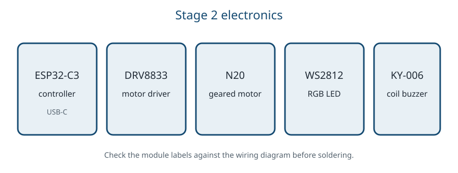
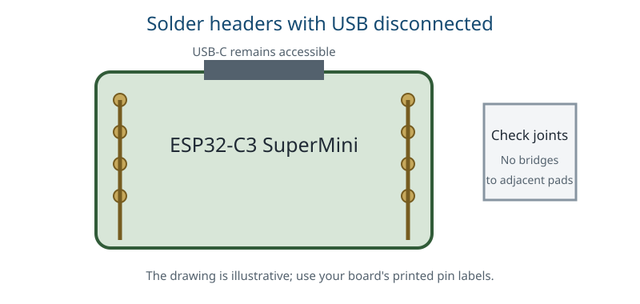
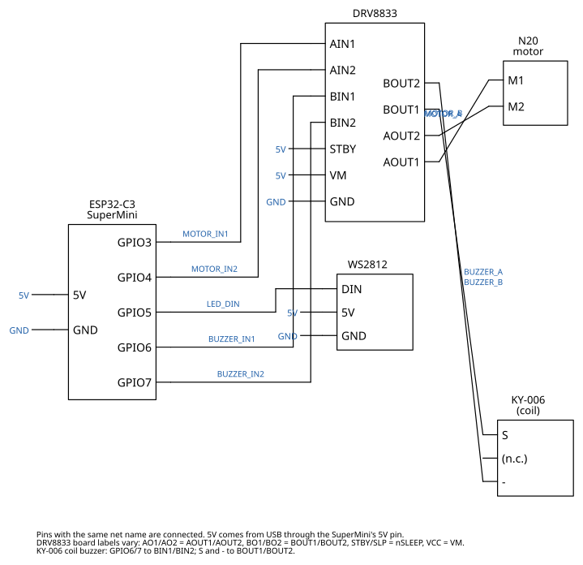
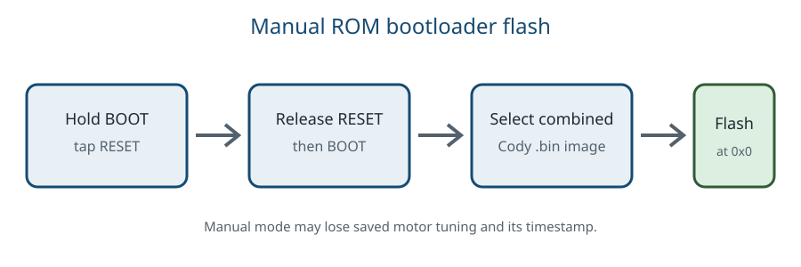
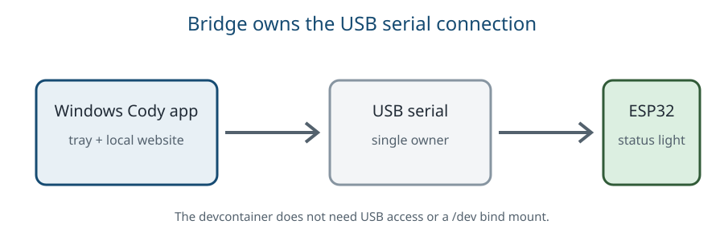
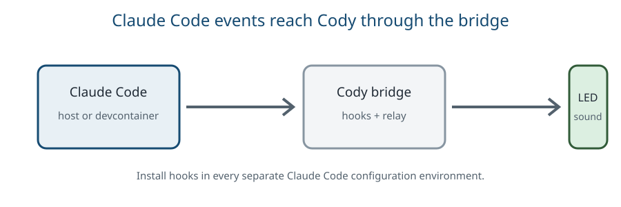
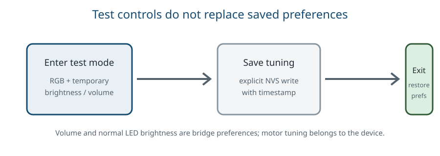

# Build the Cody status light

These Stage 2 instructions cover the electronics and software setup only. The printed figure, mechanism, fasteners and final parts list are added in later stages. See the [Stage 2 parts list](parts-list.md); it is not yet a complete Cody bill of materials.

The wiring diagram is the source of truth for connections: [electronics/wiring.svg](../electronics/wiring.svg). Work with USB disconnected while soldering or changing wires. Do not add a second power supply; the device is powered from one USB port.

## Step 1: Identify the modules

**Parts:** ESP32-C3 SuperMini, DRV8833 motor driver, N20 geared motor, WS2812 LED module, KY-006 passive buzzer, header pins and hookup wire.

**Tools:** Multimeter, soldering iron and solder, wire cutters, USB-C data cable.

Check the part labels against the parts list and wiring diagram before soldering. The KY-006 on the bench is a coil buzzer; measure between `S` and `-`. A reading in the tens of ohms identifies the coil type used by the diagram.

## Step 2: Solder the headers and leads

**Parts:** The ESP32-C3, DRV8833, WS2812 and KY-006 modules, plus header pins and hookup wire.

**Tools:** Soldering iron, solder, wire cutters and a multimeter.

Solder header pins to the module pads and solder leads to the pins needed by the wiring diagram. Keep the ESP32 USB connector accessible. Check each solder joint for a bridge to an adjacent pad and use the meter to confirm continuity before connecting power.

## Step 3: Wire the modules

**Parts:** The soldered modules, N20 motor and hookup wire.

**Tools:** Multimeter and the [wiring diagram](../electronics/wiring.svg).

With USB disconnected, wire every pin by its net label in the diagram:

- ESP32 `5V` to DRV8833 `VM` and `STBY`, and WS2812 `5V`; ESP32, driver and LED grounds share `GND`.
- ESP32 GPIO3/GPIO4 to driver `AIN1`/`AIN2`; driver `AOUT1`/`AOUT2` to the two motor leads.
- ESP32 GPIO5 to WS2812 `DIN`.
- For the coil buzzer, ESP32 GPIO6/GPIO7 go to `BIN1`/`BIN2`; buzzer `S`/`-` go to `BOUT1`/`BOUT2`.

Board labels vary: `IN1`/`IN2` may mean `AIN1`/`AIN2`, `VCC` may mean `VM`, and `SLP` may mean `STBY`/`nSLEEP`. Verify the labels on your board. A piezo buzzer reads open circuit and is not compatible with the coil wiring shown; use the coil variant specified in the parts list.

## Step 4: Flash the firmware

**Parts:** The wired ESP32-C3 and a USB-C data cable.

**Tools:** Windows Cody app, a combined Cody firmware `.bin` file, and the device `BOOT` and `RESET` buttons.

Install and start the Windows Cody app before connecting the board. Open the hardware test panel from the Cody website. For an unprogrammed board, select **Manual ROM bootloader flash**. Hold `BOOT`, tap and release `RESET`, then release `BOOT`; choose the combined firmware image in the browser file picker and confirm the target port. For a recognized Cody device with firmware that supports `TUNING?`, use **Update connected Cody device** to preserve saved motor tuning.

Use the release asset `cody-firmware-<version>.bin`, which contains the bootloader, partition table and application. For a local PlatformIO build, use `firmware.factory.bin`, not the app-only `firmware.bin`. Manual ROM flashing does not back up tuning; saved tuning and its timestamp may be lost. A successful flash resets the board into the new firmware.

## Step 5: Install and start the bridge on Windows

**Parts:** A Windows host, the assembled status light and its USB cable.

**Tools:** The versioned Cody setup installer.

Run `cody-<version>-windows-setup.exe` and start Cody from the notification area. The installer enables autostart by default. Cody owns the serial port and serves the local website; do not attach the device to the devcontainer or run another serial bridge at the same time. WSL2 and devcontainers on that Windows host reach Cody through its relay.

Native Linux hosts have no bridge between Stage 3 and Stage 6 step 6a (TD-15).

## Step 6: Install Claude Code and Copilot hooks

**Parts:** The running bridge host and each environment where Claude Code or Copilot runs.

**Tools:** Python 3.10 or newer for the Claude Code installer; VS Code with Copilot; and `curl` (`curl.exe` on Windows) wherever an agent hook runs.

From the repository, run `uv run python hooks/install-claude-code`. With the release file, run `python3 cody-install-claude-code-<version>`. Run the installer on the host and in each separate Claude Code configuration environment; a shared devcontainer configuration only needs one install. For a Docker Engine devcontainer in WSL2, pass the relay port shown by Cody, for example `--port 8766`.

For Copilot, follow the copy instructions in [`hooks/README.md`](../hooks/README.md#github-copilot-in-vs-code) to place the user hook configuration and forwarders in `~/.copilot/hooks/` (or `$COPILOT_HOME/hooks/`). Repeat in the environment where VS Code's Copilot session runs. If the Docker Engine WSL2 relay uses a non-default port, update the Docker-gateway target in both Copilot forwarders. Start a new Claude Code and Copilot session after installation.

## Step 7: Test the hardware and set preferences

**Parts:** The assembled status light and connected host.

**Tools:** Browser, Cody website and the serial replies shown in its hardware test panel.

Enter test mode before using the panel. Try a state preset, start and stop the motor, show an RGB colour, then set the LED test brightness and choose **Apply brightness**. That applies the entered colour first and then the temporary brightness; ending test mode restores the saved bridge preference. Test buzzer sounds with the test-volume slider.

Motor tuning changes take effect immediately but are saved on the device only with **Save tuning**. **Factory reset** writes firmware defaults to the device. Volume and normal LED brightness are user preferences stored by the Windows bridge; save configuration changes and restart the bridge to apply them. The test-panel brightness and volume are temporary and do not replace those preferences.

## Troubleshooting

| Symptom | Check |
|---|---|
| The bridge does not recognize the board | Check the USB data cable and port. For old or unprogrammed firmware, use Manual ROM bootloader flash. |
| The update flow reports `TUNING?` is unsupported | Use Manual ROM bootloader flash; it may erase saved tuning. |
| No LED or motor output | Disconnect USB, then compare every wire and board label with the wiring diagram; check the shared ground and 5 V net. |
| Cody is unavailable on a native Linux host | Native Linux support is deferred until Stage 6 step 6a; use the Windows bridge and its WSL relay in the interim. |
| Hook events do not reach Cody | Confirm the bridge is running, rerun the hook installer in the Claude Code environment, and restart Claude Code. |
