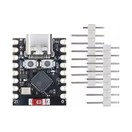
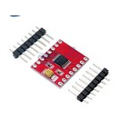
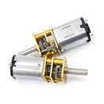
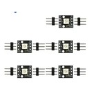
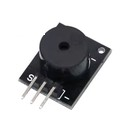

# Parts list

Everything needed to build one Cody (DOC-01 in [spec/requirements.md](../spec/requirements.md)). **Draft:** only the electronics bought for the bench (stage 2) so far; printed parts, fasteners and consumables follow with stages 4 and 5. The motor speed (300 or 500 rpm) is chosen in stage 4.

Prices are what was paid on 2026-11-06, including the price of a whole pack where parts only come in packs. The budget for one Cody is CHF 25 for the purchased parts without filament and tools (ELE-06).

## Purchased parts

| Picture | Part | Qty per Cody | Variant to order | Source | Price paid (CHF) | Per Cody (CHF) |
|---|---|---|---|---|---|---|
|  | ESP32-C3 SuperMini development board (controller, TD-01) | 1 | "C3 Super mini" | TENSTAR Store: "TENSTAR ROBOT ESP32-C3 ESP32-S3 ESP32-H2 ESP32-C6 Development …" | 2.06 each (2 bought: 1 spare) | 2.06 |
|  | DRV8833 dual H-bridge motor driver board (ELE-03) | 1 | "DRV8833" | Realpoy Electronic Components Wholesale Store: "TB6612 DRV8833 Dual Motor Driver 1A TB6612FNG for Arduino …" | 0.85 each (2 bought: 1 spare) | 0.85 |
|  | N20 geared DC motor, 6 V (GA12-N20) | 1 | "300RPM, Single motor, 6V" or "500RPM, Single motor, 6V" (decided in stage 4) | Bobo01 Store: "GA12-N20 DC 3V 6V 12V Micro Metal Gear Motor Gear Wheel Gear Mot…" | 2.62 (300 rpm), 2.66 (500 rpm) | 2.62 |
|  | WS2812 single RGB LED module, 5 V (status LED) | 1 | "5pcs" | HHKFYD Module Store: "1-10pcs Electronic building block one RBG 1Bit low power long life WS28…" | 1.42 per pack of 5 | 1.42 |
|  | KY-006 passive buzzer module | 1 | "Passive Buzzer, 5PCS" | ZC Technology Store: "Passive Speaker Buzzer Module for Arduino Boards KY-006" | 1.21 per pack of 5 | 1.21 |

**Subtotal for one Cody:** CHF 8.16 (whole packs counted; CHF 6.05 counting only the pieces used). Spares are not counted.

**Still missing:** USB-C data cable; connectors and wires; printed parts; screws; steel wire for the connecting rods; optionally a level shifter board (74AHCT125) for the LED data line.

## Printed parts

Follows in stage 5 (file, material, quantity).

## Fasteners and consumables

Follows in stages 4 and 5.

## Notes

- **Buzzer:** "passive" says nothing about how it makes sound. Measure between `S` and `-` before wiring: open circuit = piezo, connect directly to a GPIO; about 16–42 Ω = coil, connect through the DRV8833's second channel. The pictured module looks like a coil type.
- **Product links:** to be added; listing titles above are cut off as in the order confirmation.
- Pictures: product photos from the shop listings.
