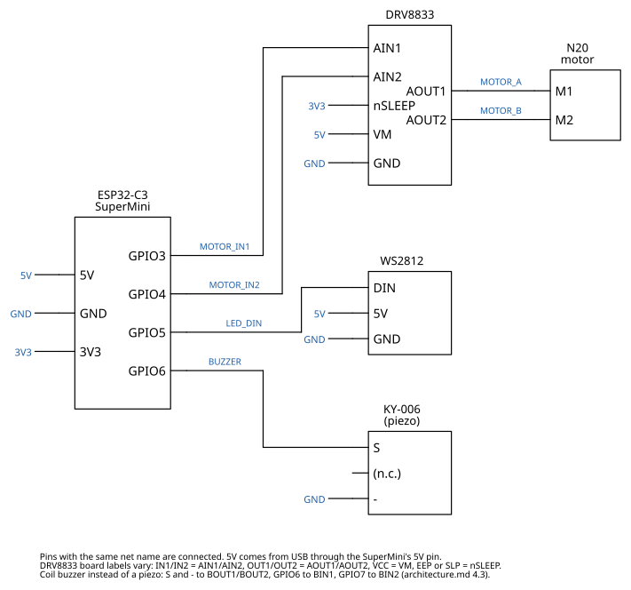

# electronics/

Wiring diagram of the status light (ELE-07 in [spec/requirements.md](../spec/requirements.md)); pins as in [spec/architecture.md](../spec/architecture.md) 4.3 and [firmware/src/pins.h](../firmware/src/pins.h). The parts list is in [docs/](../docs/) (DOC-01).



- Modules are blocks with their pin names; blue labels are net names. Pins with the same net name are connected: signal nets are drawn as wires, the power nets `5V`, `3V3` and `GND` only as labels.
- `5V` comes from the USB port through the SuperMini's `5V` pin and feeds the motor driver and the LED (ELE-04: one USB port, no second supply).
- The buzzer is drawn as a piezo. If yours measures about 16–42 Ω between `S` and `-`, it is a coil buzzer: connect `S` and `-` to `BOUT1`/`BOUT2` of the DRV8833, `GPIO6` to `BIN1` and `GPIO7` to `BIN2`.
- DRV8833 boards label their pins differently: `IN1`/`IN2` = `AIN1`/`AIN2`, `OUT1`/`OUT2` = `AOUT1`/`AOUT2`, `VCC` = `VM`, `EEP` or `SLP` = `nSLEEP`.
- Draft: confirmed against the real wiring on the bench in step 2d.

The SVG is generated; edit [wiring.py](wiring.py), then run:

```bash
uv run python electronics/wiring.py
```

`ci/check` fails if the committed SVG doesn't match the script, or if the GPIOs differ from the firmware.
