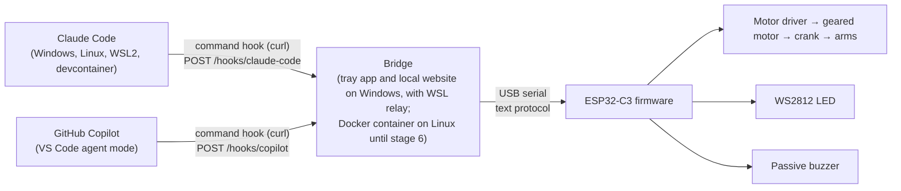

# Cody – Architecture

How the requirements in [requirements.md](requirements.md) are met. Requirements say *what*; this document says *how*. Every choice that was open is recorded: key technologies as decision records in section 5, everything else in the section it belongs to; choices that change the architecture also get a row in "Decisions" in [README.md](README.md).

## 1. Context and scope

Cody is built for the owner's own desk; the repository is open, and others can rebuild it from the parts list and assembly instructions (DOC).

External systems: Claude Code and GitHub Copilot (their hook mechanisms), the host's USB port (data and all power), Meshy.ai (generates the head mesh, used manually), GitHub (CI, releases, GHCR).

Out of scope: arm home-position sensor; Wi-Fi/Bluetooth on the device.

## 2. Constraints

- Power and data through one USB port of the host, ≤ 500 mA in total (ELE-04).
- Parts budget ≤ CHF 25 (ELE-06); printer Prusa MK3S+, FDM, PLA/PETG (FIG-03).
- Ready-made modules only; soldering limited to header pins and wires (ELE-01, ELE-02).
- Host: Windows or Linux. On Windows the bridge app (TD-06) opens the ESP32's COM port directly and serves the local website (TD-08); WSL2 and its devcontainers reach the bridge through the WSL relay (4.6), in any WSL networking mode. Firmware flashing is performed by the Windows bridge; the devcontainer does not receive USB device access. On Linux the bridge runs as a Docker container (TD-04) until the native Linux build (BRG-19, stage 6).
- Claude Code on native Windows runs command hooks in Git Bash (PowerShell without Git for Windows), so Git for Windows is needed there for the curl hooks; the setup guide says so.
- GitHub Copilot's agent hooks are in Preview and may change; they provide no session id and no events for approval or failed turns.

## 3. Overview

| Folder | Content | Technology / tool |
|---|---|---|
| `spec/` | Specification | Markdown |
| `ci/` | Entry points for CI and releases (delivery.md 2) | Shell |
| `firmware/` | ESP32-C3 firmware with host unit tests | C++, Arduino-ESP32, PlatformIO (TD-01, TD-02) |
| `bridge/` | Host bridge for Linux: HTTP in, serial out, config, Dockerfile, compose file. Frozen (fixes only) since 2026-11-21; retired in stage 6 | Python, Docker (TD-03, TD-04) |
| `bridge-go/` | Bridge app for Windows (tray, autostart, HTTP API and website, serial out, config, log, updater) and the WSL relay (4.6) in one Go module; NSIS installer script. Native Linux and macOS builds in stage 6 | Go, NSIS (TD-06, TD-08, TD-09) |
| `cli/` | Host command `cody`: status and manual state (BRG-11, BRG-12), setup (AGT-10) | Bash, curl |
| `hooks/` | Hook installers and configuration for Claude Code and Copilot, setup guide | Python (standard library), shell, JSON |
| `cad/` | Code-CAD models, head mesh pipeline, model checks, print notes | Python, build123d, manifold3d (TD-05) |
| `electronics/` | Wiring diagram: SVG block diagram of the modules with named pins and named nets, generated from a Python script | Python, schemdraw |
| `docs/` | Build documentation: parts list and assembly instructions (DOC) | Markdown, pictures and renders |
| `tools/` | Requirement report and developer utilities; the hardware test panel is served by `bridge-go/` | Python |

## 4. Interfaces

### 4.1 Hooks → bridge (HTTP)

The hooks contain no logic: they forward the agent's own hook payload. All mapping lives in the bridge, so it is tested in CI with recorded payloads.

- Port `8765`. The Docker bridge on Linux listens only on loopback and the local Docker interfaces, including the default bridge gateway `172.17.0.1` (BRG-08): its container uses the host network and binds exactly the configured addresses (`listen`, default `127.0.0.1` and `172.17.0.1`); only loopback and Docker's address range `172.16.0.0/12` are accepted. The hooks are command hooks using curl that try `localhost`, then `host.docker.internal`, then `172.17.0.1`, within 1 s in total (AGT-07), so the same configuration works on the host and in devcontainers (AGT-11), also with Docker Engine in WSL2, where `host.docker.internal` is not defined. On Windows the bridge app listens only on `127.0.0.1:8765`: the Windows host reaches it on `127.0.0.1`, Docker Desktop devcontainers on `host.docker.internal`, and WSL2 on `127.0.0.1` or the WSL relay; devcontainers in Docker Engine in WSL2 use the relay on `172.17.0.1` and its first available port from `8766`–`8770` (4.6). The hook installer’s optional `--port` sets only the `172.17.0.1` target port (default `8765`); set it to the port reported by the relay. The other targets stay on `8765` (AGT-12). Devcontainers that share the Claude Code configuration (e.g. the `claude-config` volume) are set up once; they need curl.
- `cody setup` (AGT-10) starts the bridge (container, or the Windows app; whether the Go program takes over `cody` and the hook installer is decided at stage 3 start) with autostart, writes the hooks of both agents at user level, checks the device connection and reports what is missing (e.g. usbipd on WSL2).
- `POST /hooks/claude-code`: Claude Code's hook JSON as is, sent by the curl command hook configured in `~/.claude/settings.json`. Session key: `session_id`; event: `hook_event_name`.
- Claude Code hook: one inline shell command per event, with no file paths, so the same text works on the host and in containers. It tries `127.0.0.1:8765`, `host.docker.internal:8765`, then `172.17.0.1:<port>` (default port `8765`, optionally set by the installer); it accepts only the bridge's `200 ok` response. Each curl attempt is capped at 0.1 s; the full hook stays under 1 s:
  `p=$(cat); for u in http://127.0.0.1:8765/hooks/claude-code http://host.docker.internal:8765/hooks/claude-code http://172.17.0.1:8765/hooks/claude-code; do r=$(printf '%s' "$p" | curl -fsS --connect-timeout 0.1 -m 0.1 -H 'Expect:' --data-binary @- "$u" 2>/dev/null) && [ "$r" = ok ] && break; done; exit 0`
  It never prints anything (stdout of some hooks goes into Claude's context) and always exits 0; the hook's own `timeout` is 2 s. The payload is piped, not passed as an argument, because tool outputs can be several MB; the bridge accepts up to 32 MB. `Expect:` stops curl from waiting for a `100 Continue` the bridge never sends.
- `hooks/install-claude-code` (Python, standard library only) merges these hooks into `$CLAUDE_CONFIG_DIR/settings.json` or `~/.claude/settings.json`, keeps all other settings, replaces earlier Cody hooks and can remove them (`--uninstall`). It is run once on the host and once for the devcontainers' shared `claude-config` volume (AGT-03); `cody setup` reuses it (AGT-10). `--port PORT` sets the `172.17.0.1` target port (default `8765`); for Docker Engine in WSL2, pass the relay listener port shown in its log. `--record FILE` additionally appends every payload to a file, for recording real payloads as test fixtures (sanitised before they are committed). It needs any Python 3 (3.10 or newer) and no packages: in the repository run it with `uv run python hooks/install-claude-code`, elsewhere with the Python at hand (`python3 cody-install-claude-code-<version>`, the release file). It is shipped as a release file (delivery.md 2). The setup guide lists what installing and running the hooks needs on each machine: Python 3.10 or newer for the installer; curl and a POSIX shell wherever Claude Code runs (host and every devcontainer; Git for Windows on a Windows host); the bridge running on the host.
- `POST /hooks/copilot`: Copilot's hook JSON, sent by a command hook (`curl -m 1 --data-binary @- …`) configured in `~/.copilot/hooks/`. Session key: workspace folder (`cwd`) (AGT-06).
- `GET /status`: device connection, firmware version, sessions with their states, merged state (BRG-11).
- `GET /`: Windows bridge website (status, configuration, test panel and updater); opened by the tray menu on the Windows host. It is served from the same loopback listener; no separate WSL/container UI access path is provided.
- `POST /state`: sets a state manually (`{"state": "WORKING"}`), as its own session `manual` (BRG-12); `DELETE /state` removes it, otherwise it ends by the session timeout.
- `DELETE /sessions`: removes all sessions, including the manual one; the merged state becomes IDLE (BRG-15).
- Host command `cody` (`cli/`): a shell script using curl on these endpoints: `cody status`, `cody state <STATE>`, `cody state clear`, `cody session clear` (BRG-15), `cody --version`; `cody setup` follows with AGT-10. Installed by copying it to `~/.local/bin`; on Windows it runs in Git Bash. It reaches the Windows app from WSL through the relay.
- Hooks return within 1 s and never fail the agent (AGT-07).

**Claude Code mapping (AGT-01):**

| Hook event | State |
|---|---|
| `SessionStart` | IDLE |
| `UserPromptSubmit`, `PostToolUse`, `PostToolUseFailure` | THINKING |
| `PreToolUse` | WORKING |
| `PermissionRequest`, `Notification` (`permission_prompt`, `elicitation_dialog`) | APPROVAL |
| `Stop` | COMPLETED |
| `StopFailure` | ERROR |
| `SessionEnd` | session ends |

**Copilot mapping (AGT-04):**

| Hook event | State |
|---|---|
| `sessionStart` | IDLE |
| `userPromptSubmitted`, `postToolUse` | THINKING |
| `preToolUse` | WORKING |
| `agentStop` | COMPLETED |
| `sessionEnd` | session ends |

THINKING vs WORKING between tool calls is approximate for both agents.

### 4.2 Host → firmware (USB serial)

USB CDC of the ESP32-C3, 115200 baud, ASCII lines terminated by `\n` (a `\r` before it is ignored). Commands and names are uppercase. A line longer than 64 characters is answered with `ERR line too long` and dropped. Every command is answered with `OK` or `ERR <reason>` (FW-10); an error never changes the state.

| Command | Meaning | Req |
|---|---|---|
| `STATE:<IDLE\|WORKING\|THINKING\|APPROVAL\|COMPLETED\|ERROR>` | Switch state | FW-03 |
| `PING` | Heartbeat | FW-06, BRG-05 |
| `VOLUME:<0-100>` | Set the user volume preference; 0 is mute | FW-09 |
| `BRIGHTNESS:<0-100>` | Set the LED brightness multiplier of the existing cap | FW-14 |
| `VERSION?` | Answered with `VERSION <version> <commit>` before `OK` | FW-11 |
| `TUNING?` | Answered with `TUNING:<speed>,<frequency_hz>,<kick_ms>,<FAST\|SLOW>,<UTC timestamp\|UNSAVED>` before `OK` | FW-13, TST-09 |
| `LED:<r>,<g>,<b>` | Test: show a colour (0–255 each) until the next `STATE` or a disconnect | FW-12 |
| `BEEP:<APPROVAL\|SUCCESS\|WARNING>` | Test: play a sound | FW-12 |

At boot the device sends `READY <version>`; the Go bridge then resends volume and brightness preferences and state (BRG-06). It queries `TUNING?` to display the device's motor tuning. Every valid command, including `PING`, counts as activity for the 30 s timeout (FW-06); the first one after power-up or a disconnect ends the "disconnected" pattern (FW-07). Sending the current state again doesn't replay its sound (FW-04: sounds play when a state is entered).

**Per-device motor tuning (FW-13, FW-15):** the ESP32 stores speed, PWM frequency, startup kick and decay mode in its built-in NVS (`Preferences`). Firmware defaults are speed 224, 10 kHz, 1 ms kick and fast decay. They are loaded at boot, or used until the first save. Only explicit save and factory reset write NVS. The Go bridge supplies a UTC RFC 3339 timestamp with each write; the device stores it with the parameters and reports it through `TUNING?`. The query returns `UNSAVED` before the first write. A write failure returns `ERR` and is not reported as successful.

**Developer test panel (TST):** the panel is a section of the Windows bridge website, opened in the Windows browser. It uses the bridge's existing device connection; it does not open serial or require a devcontainer server. The bridge remains the sole serial owner. The panel sends a heartbeat every 2 s; closing the page stops the test immediately when possible, and a 10 s heartbeat expiry otherwise ends it. Normal agent events continue to update the merged state while device writes are suspended. On stop or expiry, the bridge sends `TEST:STOP` and applies the latest merged state.

| Test command | Meaning | Req |
|---|---|---|
| `TEST:START` / `TEST:STOP` | Enter/exit test mode; exit clears raw test outputs before the bridge restores the merged state | TST-01, TST-07, TST-08 |
| `TEST:STATE:<IDLE\|WORKING\|THINKING\|APPROVAL\|COMPLETED\|ERROR>` | Apply a normal state preset without exiting test mode | TST-02 |
| `TEST:MOTOR:START` / `TEST:MOTOR:STOP` | Start/stop the motor independently of the state preset | TST-03 |
| `TEST:SPEED:<0-255>` | Set the shared motor speed | TST-03 |
| `TEST:FREQ:<1000-30000>` | Set the shared motor PWM frequency in Hz | TST-03 |
| `TEST:KICK:<0-100>` | Set the shared startup kick in milliseconds | TST-03 |
| `TEST:DECAY:<FAST\|SLOW>` | Select DRV8833 fast or slow decay | TST-03 |
| `TEST:VOLUME:<0-100>` | Set temporary test volume using the same volume curve; `0` is mute | TST-05 |
| `TEST:LED:<r>,<g>,<b>` | Temporarily show a colour, with the 50% brightness cap | TST-04 |
| `TEST:BRIGHTNESS:<0-100>` | Temporarily override brightness for the raw LED test colour, using the existing gamma curve and 50% cap | TST-11 |
| `TEST:BEEP:<APPROVAL\|SUCCESS\|WARNING>` | Play a test sound once | TST-05 |
| `TEST:TUNING:SAVE:<UTC timestamp>` | Persist the current motor tuning and supplied timestamp to NVS | FW-13, TST-09 |
| `TEST:TUNING:RESET:<UTC timestamp>` | Restore firmware motor-tuning defaults and persist them with the supplied timestamp | FW-15, TST-09 |

`TEST:*` commands other than `TEST:START` are accepted only in test mode. While test mode is active, normal `STATE`, `VOLUME`, `BRIGHTNESS`, `LED` and `BEEP` commands are rejected so they cannot override it; `PING`, `VERSION?` and `TUNING?` remain available. Exiting test mode sets IDLE and clears temporary motor/LED/sound overrides; the bridge then resends its current preferences and latest merged state. Motor tuning edits take effect in RAM and apply to normal WORKING behavior after test mode; they survive reboot only after explicit save. Test volume is temporary. The LED test brightness slider starts at the saved bridge brightness, and its temporary override applies only to the raw test colour; it does not change the saved preference and is cleared on test exit. A test LED colour and test beep do not alter normal state colours or sounds.

The bridge website issues `TEST:TUNING:SAVE` and `TEST:TUNING:RESET` only while test mode is active. When the page opens, the bridge queries `TUNING?`; after a save or reset it queries again and updates the displayed values. The page renders a returned UTC timestamp in local date and time, and shows “Firmware defaults (never saved)” for `UNSAVED`.

Firmware flashing uses the Windows Go bridge's test panel (TST-10), with no `/dev` bind mount, USB device mapping, or `usbipd` attachment to the devcontainer. The **Manual ROM bootloader flash** mode works for a first-time board or an existing Cody device, recognized or not: select an Espressif serial port and enter ROM bootloader mode by holding BOOT, tapping and releasing RESET, then releasing BOOT. This mode does not snapshot tuning; the confirmation warns that saved tuning and its timestamp may be lost. To preserve tuning, use **Update connected Cody device**, which snapshots tuning and its timestamp before flashing and restores them after reconnect; `UNSAVED` remains unsaved. If the current firmware does not support `TUNING?`, use manual mode instead. Select the combined Cody image (`cody-firmware-<version>.bin`, containing bootloader, partition table and app) from the Windows filesystem; the bridge flashes it at address `0x0` through the pinned `espflash` helper. In either mode, the bridge exits test mode and reapplies current user preferences and merged agent state after reconnect. The GitHub release-checking updater remains a separate Stage 6 feature.

### 4.3 Device behaviour (defaults, tuned on the bench in step 2d)

| State | LED (r,g,b and effect) | Sound | Arms |
|---|---|---|---|
| IDLE | blue (0,0,255) steady at 15 % | – | stopped |
| WORKING | blue (0,0,255) pulsing 20–100 %, period 2 s | – | motor at saved/current device speed |
| THINKING | yellow (255,160,0) steady at 50 % | – | stopped |
| APPROVAL | orange (255,60,0) blinking 1 Hz | double beep: 2 × 100 ms at 2.7 kHz, 100 ms apart | stopped |
| COMPLETED | green (0,255,0) steady at 50 % | success: rising 2.0 / 2.5 / 3.0 kHz, 100 ms each | stopped |
| ERROR | red (255,0,0) blinking 2 Hz | warning: falling 3.0 / 2.0 kHz, 200 ms each, twice | stopped |
| disconnected (FW-06, FW-07) | white slow pulse 0–10 %, period 4 s (unobtrusive at night) | – | stopped |

- LED brightness is capped at 50 % of full scale (ELE-04); the percentages above are relative to that cap. For bridge brightness slider value `x`, use `b=(x/100)^2.2`, then apply `b` to the capped RGB channels: `Rout=round(Rin_capped × b)`, likewise for green and blue. The default is 100%; raw test colours use the same multiplier.
- Buzzer: PWM at the tone frequency; for slider value `x` from 0 to 100, duty is `round(512 × (x/100)^2.5)`. Thus 0 is mute and 100 is the existing LOUD output. The bridge default and test-panel slider position are 50%; slider steps are 1%. A coil buzzer is driven through the DRV8833's second channel instead of a GPIO.
- Motor: PWM at 10 kHz; 1 ms full-duty kick on start, then apply the current device tuning; firmware defaults are speed 224 and fast decay. Speed 0 stops the motor. The test panel can adjust frequency from 1–30 kHz, kick from 0–100 ms, and select fast/slow decay. The default is fast decay: PWM on AIN1 with AIN2 low. Slow decay uses AIN1 high and PWM on AIN2, per [TI's DRV8833 datasheet, section 7.3.2, Table 2](https://www.ti.com/document-viewer/DRV8833/datasheet/detailed_description#SLVSAR16465). Unsaved motor tuning is volatile; saved tuning and its timestamp persist in NVS.

Default pins of the ESP32-C3 SuperMini (avoiding the boot pins 2, 8, 9 and the USB pins 18, 19), confirmed with the wiring diagram in step 2d (ELE-07):

| Signal | GPIO |
|---|---|
| DRV8833 AIN1 / AIN2 (motor; PWM pin depends on decay mode) | 3 / 4 |
| WS2812 data | 5 |
| Buzzer PWM / DRV8833 BIN1 | 6 |
| DRV8833 BIN2 (held low for the coil buzzer) | 7 |

The bench KY-006 measured 15 Ω across its signal and ground pins and is wired as a coil buzzer through the DRV8833's second channel. On the breakout used, `STBY` is the sleep/enable pin and is tied to 5 V as the manufacturer specifies; `AO1`/`AO2`, `BO1`/`BO2` label the `AOUT1`/`AOUT2`, `BOUT1`/`BOUT2` outputs. A confirmed piezo buzzer may be driven directly from GPIO6.

### 4.4 Bridge configuration (BRG-07)

**Docker bridge (Linux, until stage 6):** `~/.config/cody/bridge.toml` on the host, mounted read-only into the container by the compose file; a missing file or key means the default. It remains frozen with its legacy keys: `serial_port` (optional override), `speed` (default 224), `volume` (default 2), `session_timeout_min` (default 10), `listen` (default `["127.0.0.1", "172.17.0.1"]`), `log_level` (`"info"` or `"debug"`, default `"info"`). It is not compatible with the new firmware settings: its `SPEED` command is no longer supported and its old 0–3 volume values are interpreted on the new 0–100 scale. Use the Windows Go app with firmware implementing TD-10; the Python bridge is retired in Stage 6.

The bridge is a Python program with the standard library's threaded HTTP server and pyserial for the port and device discovery. It finds the device among the serial ports by Espressif's USB vendor ID (`303A`) and accepts it only after `VERSION?` is answered (FW-11). It sends `PING` every 5 s (BRG-05).

Log (BRG-13, BRG-14): the bridge writes lines `YYYY-MM-DD HH:MM:SS LEVEL message` to stdout, for example `2026-11-06 14:02:11 INFO  state WORKING (sent) <- claude-code 3f2a1c PreToolUse`. Docker keeps them in its json-file log, limited by the compose file to 2 files of 10 MB (`max-size`, `max-file`); read with `docker compose logs`. Info: state changes with cause and delivery, device connects and losses, config. Debug: every event, and every command (`->`) and reply (`<-`) on the serial line. The container uses the host network and sees replugged devices through `/dev` mounted with a device cgroup rule for `ttyACM` devices.

**Windows app (TD-06):** same session, HTTP and log behavior as above; it uses the current firmware protocol and settings described below, unlike the frozen Python bridge. Differences:

- Config `%APPDATA%\cody\bridge.toml`: `volume` (0–100, default 50), `brightness` (0–100, default 100), `session_timeout_min` (default 10), optional `serial_port`, `log_level`, and `wsl_distros` (default: WSL's default distribution if WSL is installed; `[]` turns the relay off, 4.6). Motor tuning is not a bridge setting. Config is read at start; the website saves edits and marks that a restart is required.
- When loading a prior Windows Go config containing the obsolete `speed` key, ignore that key and reset the old volume value to the new defaults (volume 50%, brightness 100%); preserve the unrelated settings. Saving the config drops `speed`.
- The installer enables autostart by default; the tray menu's "Start automatically" checkbox can turn it off or back on without admin rights.
- Device: found among the COM ports by USB vendor ID `303A` (go.bug.st/serial enumerator), accepted after `VERSION?` is answered (FW-11). The bridge sends volume and brightness preferences, but never a motor speed; motor tuning belongs to the device.
- Log `%LOCALAPPDATA%\cody\bridge.log`, rotated by the app (lumberjack) at 10 MB with one old file kept, so at most 2 files of 10 MB (BRG-14); the relay's output goes into the same log, marked `relay <distro>`.
- Tray (BRG-16, BRG-17, BRG-20): a notification-area icon in the colour of the merged state (colours of 4.3); its tooltip and menu show the version, device connection (port and firmware version), merged state and number of sessions. Menu: "Open Cody" (opens the local website in the default browser), "Start automatically" (tick box, BRG-09), "Open log", "Restart", "Quit". There is no native Cody window. The tray app remains a Windows GUI-subsystem program (`-H=windowsgui`); WSL child processes are also created without console windows.
- Autostart (BRG-09, BRG-16): the tick box writes or removes the value `Cody` (path of `cody.exe`) under `HKCU\Software\Microsoft\Windows\CurrentVersion\Run`; no admin rights. Only one instance runs (a named mutex); a second start ends at once.
- Installer (BRG-18): `cody-<version>-windows-setup.exe`, built with NSIS (`makensis` in the devcontainer) from `bridge-go/installer/`. Per user, without admin rights (`RequestExecutionLevel user`): installs `cody.exe`, `cody-linux` (the relay), the pinned `espflash.exe` helper and its license notices into `%LOCALAPPDATA%\Programs\Cody`, adds a Start menu entry and an uninstaller listed under "Installed apps" with the version (HKCU), ends a running app before replacing files, and offers "Start Cody now" on its last page. The installer enables autostart by default. The uninstaller removes the files, the Start menu entry and the autostart value, and keeps config and log. Unsigned: SmartScreen asks once ("Run anyway").

**Local website (BRG-20 – BRG-22, TST-09 – TST-10, TD-08):** the existing Go `net/http` server serves embedded HTML, CSS and JavaScript at `http://127.0.0.1:8765/`; no separate frontend runtime or build toolchain. The page shows bridge version and commit, firmware version and connection status, merged state and sessions, each configured WSL distro's actual relay port, and route guidance: WSL-host hooks use `127.0.0.1:8765`; Docker Engine devcontainer hooks in WSL2 use `172.17.0.1:<relay-port>`. The latter is not the Windows bridge's internal port. Volume and brightness are 0–100% sliders with a 1% step; volume uses `round(512 × (x/100)^2.5)` and defaults to 50%, brightness defaults to 100%. The page also queries and displays device motor tuning and its local last-write date, allows edits through the test panel, and provides explicit Save and Factory reset controls. It shows “Firmware defaults (never saved)” if the device has no saved timestamp. The test panel's Manual ROM bootloader flash mode lists Espressif (`303A`) serial ports, allows selecting a port even when its Cody firmware is recognized, and guides entry to ROM bootloader mode. It warns that this mode skips tuning backup and saved tuning may be lost. The separate update mode requires a connected Cody device and snapshots saved tuning and timestamp through the Cody protocol; it fails closed if that query is unsupported. In both modes it accepts a selected, non-empty `.bin` file up to 4 MiB and explains that the user must choose a combined Cody image. Before upload and flashing, a browser confirmation names the selected file and target port and warns that it replaces the firmware. The loopback bridge validates filename extension, non-empty content and size, releases the COM port, and runs the pinned `espflash` helper to write at `0x0`. It shows the current phase and captured helper output/errors rather than a percentage. After a tuning-preserving update, it restores the tuning snapshot and original timestamp through the Cody protocol; an `UNSAVED` device remains unsaved. On success or failure it leaves test mode, reacquires the port and restores current preferences and the latest merged state when the device reconnects; it reports if the device remains disconnected and allows retry after reconnection. The settings page edits `wsl_distros`, volume, brightness, `session_timeout_min`, optional `serial_port`, and `log_level`; it validates and saves the existing TOML config file; edits are not live-applied. The page clearly says a restart is required and provides "Restart now". There is no login; the site is served only on loopback and browser mutation endpoints validate the same origin. This protects browser actions from cross-site requests but is not authentication against other local processes.

#### Windows firmware updater (BRG-23, BRG-24, TD-09)

The updater is initially Windows-only and is part of the local website. Checking is user-initiated; it queries the latest stable release of `gravity981/agent-cody`, displays the installed and available firmware versions, and requires explicit confirmation before downloading. Network and release errors are shown, never treated as "no update". If the installed version is known and equal to or newer than the release, it reports that no update is available. If the installed version is unknown, it identifies that fact and permits flashing only after explicit confirmation.

After confirmation, the app downloads only `cody-firmware-<version>.bin` from that release and verifies its SHA-256 digest from GitHub release asset metadata before flashing. Missing or mismatched digests fail closed. The app suspends device writes, releases the selected COM port and runs the pinned Windows `espflash` helper to write the combined image at address `0x0`. The helper runs without a console window; its output is captured and shown as website progress and errors. It first attempts automatic bootloader entry; if that fails, the page gives manual bootloader instructions and allows a retry. The bridge reacquires the port after success or failure, then resends settings and the latest merged agent state and displays the resulting firmware version or an explicit failure.

### 4.5 Mechanical interfaces

- Head ↔ torso: socket designed in code CAD and cut into the head mesh by the pipeline (TD-05).
- Electronics: modules mounted on a removable plate or compartment in the platform; USB port accessible from outside (FIG-14).
- Status LED (FW-01): the WS2812 sits in the laptop lid, behind the screen printed in white or translucent PLA. The screen faces the figure, so the light falls on its face, hands and hoodie and reaches the user indirectly, without glare. A small hole in the back of the lid lets some light through towards the user. The lid is fixed (no hinge); the three LED wires run through it into the platform; the LED is reachable for service (FIG-14). Lid size and angle must leave the typing hands visible from the user's side (FIG-01).

### 4.6 WSL relay (AGT-12)

WSL2 in NAT mode and devcontainers in Docker Engine in WSL2 cannot reach `127.0.0.1` of Windows, and no network mode is forced on them. The Windows app therefore brings the bridge into WSL:

- For each distribution in `wsl_distros`, the app starts `wsl.exe -d <distro> -e <install folder as /mnt/… path>/cody-linux relay` and starts it again (after 5 s) when it ends. While the app runs, it keeps that WSL distribution running.
- The relay (Linux build of the same Go module) listens in WSL on `127.0.0.1:8765` and on `172.17.0.1` using the first available port in `8766`–`8770` (retried every 5 s while the Docker gateway is unavailable or all candidate ports are occupied). Set the hook installer’s `--port` to the actual gateway listener port shown in the relay log. The relay accepts only loopback and `172.16.0.0/12` (BRG-08), and tunnels every TCP connection as a yamux stream over its stdin/stdout to the app, which connects it to its own `127.0.0.1:8765`. Before yamux starts, the relay writes a binary marker; the app waits for it and discards any preceding WSL startup output so it cannot corrupt the tunnel stream. Hook and CLI endpoints are supported through it; the website is intended for the Windows browser and has no separate WSL/container UI route. The `cody` command remains unchanged.
- No TCP from WSL to Windows, so no firewall rule and no dependency on the networking mode. In mirrored mode `127.0.0.1` in WSL may already reach the app directly and reserve port `8765`; if so, the relay serves `172.17.0.1` only, on its selected alternate port.
- The Linux Docker bridge must not run in the same WSL distribution (it would own its configured listen ports); on a Windows host the Windows app replaces it.

## 5. Technology stack

### 5.1 Overview

| Area | Choice | Version | Decision |
|---|---|---|---|
| Controller board | ESP32-C3 SuperMini | – | TD-01 |
| Firmware framework | Arduino-ESP32 3.x with PlatformIO (pioarduino platform) | PlatformIO 6.2.0, pioarduino 55.03.312-1; toolchain baked into the devcontainer image | TD-02 |
| Bridge (Linux, until stage 6) | Python | 3.14 | TD-03 |
| Bridge runtime (Linux, until stage 6) | Docker container, image on GHCR | – | TD-04 |
| Bridge app (Windows) and WSL relay | Go; fyne.io/systray, go.bug.st/serial, hashicorp/yamux, pelletier/go-toml/v2, natefinch/lumberjack; tests with go test and gotestsum (JUnit) | Go 1.27.4, gotestsum 1.13.0; libraries pinned in `go.sum` | TD-06 |
| Windows installer | NSIS (`makensis`) | 3.08-3+deb12u1 from Debian Bookworm | TD-06 |
| CAD | build123d; head mesh from Meshy.ai, processed with manifold3d | build123d 0.13.0, manifold3d 3.5.4 | TD-05 |
| CI environment | Devcontainer (devcontainers/ci), Docker via docker-outside-of-docker | – | delivery.md 2 |
| Python dependencies | uv workspace (members `bridge`, `cad`, `tools`) with one lockfile `uv.lock`; tests with pytest | uv 0.13.7, pytest 9.2.0 | this table |
| Static checks | ruff (Python), clang-format (C++), shellcheck (shell), gofmt and go vet (Go, from step 2g) | ruff 0.17.3, clang-format 23.1.5, shellcheck 0.11.0, Go's own tools | this table |
| Wiring diagram (ELE-07) | schemdraw (Python), SVG output | pinned in `uv.lock` when added in step 2d | this table |
| Bridge website and hardware test panel | Go `net/http`, embedded HTML/CSS/JavaScript; test controls through the bridge-owned device connection | Go 1.27.4; no frontend runtime | TD-08 |
| Windows firmware updater helper | `espflash` standalone Windows binary; version and SHA-256 pinned in release build | v4.7.0 at decision time | TD-09 |

Every tool has a pinned version and is installed in the devcontainer (`.devcontainer/`), never only on someone's machine. How CI gets the same tools is decided in delivery.md 2.

### 5.2 Decision records

Records are numbered `TD-<nn>` and never renumbered; a revised decision gets a new record and the old one is marked `superseded by TD-<nn>`.

#### TD-01 Controller board: ESP32-C3 SuperMini

**Status:** decided (2026-11-05)

**Context:** FW, ELE-04 (≤ 500 mA), ELE-06 (≤ CHF 25 for all parts), fits inside the platform. Needs 4 outputs (motor ×2, LED, buzzer) and USB serial.

**Options evaluated:** ESP32-C3 SuperMini (~CHF 2–4, 22 × 18 mm, native USB, few pins, varying clone quality); ESP32-S3 Zero/mini (~CHF 5–8, more than needed); classic ESP32 DevKitC (~CHF 5–8, large, USB-UART chip resets the board when the port opens).

**Decision:** ESP32-C3 SuperMini: cheapest, smallest, native USB, low power; enough pins.

**Consequences:** Buy two (cheap; clones vary). Native USB CDC: the serial port disappears on reset, which the bridge's reconnect handles (BRG-06).

#### TD-02 Firmware framework: Arduino-ESP32 with PlatformIO

**Status:** decided (2026-11-05)

**Context:** FW-01 – FW-12: WS2812, PWM tone, PWM motor, line parser; unit tests in CI without hardware.

**Options evaluated:** Arduino core + PlatformIO (easy libraries, host unit tests in the `native` environment, CLI fits CI; official PlatformIO lags behind Arduino-ESP32 3.x, so the community `pioarduino` platform is used); ESP-IDF (official, Unity tests incl. Linux target, more boilerplate); MicroPython (quick, weaker timing, harder to unit-test in CI).

**Decision:** Arduino-ESP32 with PlatformIO. Logic (parser, state machine, timing) is kept free of Arduino calls so it runs in the `native` test environment.

**Consequences:** Depends on the community `pioarduino` platform; if it stalls, revisit with ESP-IDF.

#### TD-03 Bridge language: Python

**Status:** decided (2026-11-05); since 2026-11-21 limited to the Linux Docker bridge, frozen, superseded by TD-06 in stage 6

**Context:** BRG-01 – BRG-12: HTTP server, serial, config, CLI; Linux/WSL2.

**Options evaluated:** Python (proposed in the original idea; pyserial, pytest, quick to change); Go (single binary, more code).

**Decision:** Python; it also serves the requirement report and the CAD scripts, so one language covers the host side.

**Consequences:** Runtime comes with the container image (TD-04).

#### TD-04 Bridge runtime: Docker container, image on GHCR

**Status:** decided (2026-11-05); since 2026-11-21 Linux hosts only, superseded by TD-06 in stage 6

**Context:** BRG-06 (reconnect after replug), BRG-08 (local interfaces only), BRG-09 (autostart), runs on Linux/WSL2.

**Options evaluated:** native systemd user service (replug works without extra setup, one install step); Docker container (`restart: unless-stopped` gives autostart, pinned runtime; serial replug needs extra setup).

**Decision:** Docker container, started with a compose file from the release; image published on GHCR by `ci/publish` and retagged by `ci/promote`.

**Consequences:** The serial device appears and disappears on replug; the container mounts `/dev` (or `/dev/serial/by-id`) with a device cgroup rule for USB CDC (`ttyACM`) instead of a fixed `--device`. Reaching the bridge from devcontainers and keeping BRG-08 needs a network setup that binds only to loopback and the Docker bridge gateway. Both are risks (section 7) to be proven in stage 2; if they fail, revisit with a native service.

#### TD-05 CAD: build123d, head mesh from Meshy.ai

**Status:** decided (2026-11-05)

**Context:** FIG-01 – FIG-17: organic head, precise torso with mechanism, sources and print files in the repository, checks in CI.

**Options evaluated:** Fusion (strong organic + mechanical, proprietary files, no CI); build123d (Python code CAD on OpenCascade, headless exports and checks in CI, organic shapes hard); CadQuery (same kernel, older fluent API, larger community); FreeCAD (open source, scriptable, awkward UI).

**Decision:** build123d for platform, table, laptop, torso, arms and mechanism. The head is generated with Meshy.ai (manual, web); the raw mesh and the prompt are committed as sources, and a script with manifold3d repairs, scales and cuts the head socket and exports the printable STL.

**Consequences:** Model checks (height, bed size, part count, files present) run in CI. Meshy's licence terms for generated models must allow use in an open repository (open point in README.md).

#### TD-06 Bridge app: Go, tray app on Windows, WSL relay, NSIS installer

**Status:** decided (2026-11-21)

**Context:** The bridge in Docker on WSL2 needs usbipd and a proven serial replug in the container (TD-04 risk); Docker on macOS can't reach USB serial devices at all. Claude Code runs on the Windows host, in WSL2 and in devcontainers (Docker Desktop, Docker Engine in WSL2), without a forced networking mode (AGT-02, AGT-12). The user wants an app with a "start automatically" tick box, not a Windows service (BRG-16), installed with an installer (BRG-18); Linux and macOS follow (BRG-19).

**Options evaluated:** Go (one static binary per OS, cross-compiles from the devcontainer without cgo on Windows and Linux, libraries for tray, serial with USB IDs, TOML, log rotation, stream multiplexing); Python with PyInstaller and pystray (reuses the bridge code, but heavy exe, antivirus false alarms, no small static relay for WSL); Rust (same strengths as Go, slower to write). For WSL access: relay started by the app through `wsl.exe` (chosen); relay as a systemd unit in WSL (second autostart, needs systemd); app listening on the WSL virtual adapter (firewall rule, misses devcontainers in Docker Engine in WSL2). Installer: NSIS (chosen, runs on Linux); Inno Setup (only under Wine, not supported there); plain exe.

**Decision:** The bridge is rewritten in Go (`bridge-go/`) as a tray app for Windows with the WSL relay (4.4, 4.6); the installer is built with NSIS. The Python Docker bridge stays for Linux hosts, frozen at the stage 2 feature set (fixes only); stage 3 features go into the Go bridge only. Stage 6 adds native Linux and macOS builds and retires the Python bridge, the image and `ci/publish`/`ci/promote`. The `cody` shell command and the Python hook installer stay; moving them into the Go program is decided at stage 3 start (AGT-10).

**Consequences:** Go toolchain, gotestsum and NSIS in the devcontainer; Go tests in `ci/check`, named `Test_req_BRG_02_…` so the requirement report reads them unchanged. Bridge logic, mapping and recorded payloads are tested on Linux in CI; Windows-only parts (tray, Run key, COM ports, `wsl.exe`, installer) are demonstrated on Windows (verification log). Two bridges exist until stage 6. The tray library must build for Windows without cgo (checked in step 2g; otherwise a pure-Go Windows tray library); macOS will need cgo for the tray (stage 6).

#### TD-07 Developer hardware test panel: local browser UI in the devcontainer

**Status:** decided (2026-11-21); superseded by TD-08

**Context:** TST-01 – TST-07. The owner needs a usable bench panel with fields and buttons, while the USB device is attached to the devcontainer. The tool is developer-only and must not change or depend on the bridge.

**Options evaluated:** Python's standard-library HTTP server with a small HTML/JavaScript UI and pyserial (no GUI framework and no new server dependency; sufficient for a local bench panel); Flask/FastAPI (convenient routing, but adds a dependency without a need for a larger API); Tkinter/Qt in the devcontainer (desktop widgets, but requires display forwarding and a GUI toolkit). A browser-only Web Serial UI is not chosen because the USB port is owned by Python in the devcontainer, not the host browser.

**Decision:** A small Python standard-library HTTP server serves the browser UI on loopback port 8766; the UI and backend communicate over same-origin HTTP, and Python directly owns the USB serial port using pyserial. The `cody-test-panel` tool is not packaged into Cody releases.

**Consequences:** Superseded in step 2k: the Windows Go bridge serves the panel and remains the sole serial owner; the Python panel, its pyserial dependency in `cody-tools`, forwarded port and direct-serial tests are removed. Device behavior still requires bench verification.

#### TD-08 Windows control interface: embedded local website

**Status:** decided (2026-11-21)

**Context:** BRG-20 – BRG-22 and TST-06, TST-08. The owner wants status, configuration and hardware test controls, and later the updater, without a native settings window. The bridge already has a loopback HTTP server and a Go tray icon.

**Options evaluated:** a native Win32 window (no new dependency, but custom Windows UI code and not reusable); Fyne (cross-platform widgets, but [Windows cross-compilation requires cgo and a target C toolchain](https://docs.fyne.io/started/cross-compiling/), conflicting with the current no-cgo build); an embedded local website (uses the existing HTTP server and existing HTML/JavaScript panel patterns, no frontend runtime or additional service).

**Decision:** retain the tray icon as the status indicator and launcher, with "Open Cody" opening the default browser at `http://127.0.0.1:8765/`. Serve embedded HTML/CSS/JavaScript from the Go app. The site has status, configuration, test panel and updater sections; the test panel is served by the bridge and never opens serial directly. The site is loopback-only, has no login, and checks same-origin on mutating browser routes.

**Consequences:** the website's configuration writes the existing TOML file and requires an app restart. The devcontainer's Python/pyserial panel is replaced. Same-origin checks protect browser mutation routes from cross-site requests, not from other local processes; the existing no-auth local bridge model remains.

#### TD-09 Firmware updater helper: espflash sidecar

**Status:** decided (2026-11-21)

**Context:** BRG-23 and BRG-24. Firmware updates must run from the Windows bridge, which owns the COM port, and must flash the existing combined image at address `0x0` without requiring Python on the user's machine.

**Options evaluated:** [`espflash`](https://github.com/esp-rs/espflash) standalone binary (native Windows executable, ESP32-C3 support, `write-bin`, dual MIT/Apache-2.0 license); Espressif [`esptool`](https://github.com/espressif/esptool) standalone binary (mature and official, but substantially larger and GPL-2.0-or-later); implement the serial bootloader protocol in Go (avoids a sidecar, but adds substantial protocol, reliability and recovery work).

**Decision:** bundle the pinned Windows x86-64 `espflash` v4.7.0 helper with the installer, including its license notices. The source archive is `espflash-x86_64-pc-windows-msvc.zip` from the official v4.7.0 release; pin and verify its SHA-256 (`2b10333e4f4f1a26024259b0cc1942ba17f27b3c530621c6111f4c10ac70213e`) before extracting `espflash.exe`. Verify the firmware release asset digest before invoking it; use `write-bin` at `0x0`.

**Consequences:** the Windows installer grows by the helper binary; the build pins its upstream version and SHA-256. Local image flashing is Windows-only in Stage 2; the GitHub release-checking updater is added in Stage 6. Native Linux/macOS updater support is not included in BRG-19 or Stage 6 unless separately specified.

#### TD-10 Motor tuning and user output preferences

**Status:** decided (2026-11-22)

**Context:** Motor tuning varies by device and needs to survive restarts; volume and brightness are user preferences. The test panel is bridge-backed (TST-06, TST-08), and the bridge website already owns settings (BRG-22).

**Decision:** Store motor speed, PWM frequency, startup kick, decay mode and the last-write timestamp in ESP32 NVS. Tuning changes take effect in RAM; only explicit Save and Factory reset write NVS. The Windows Go bridge supplies UTC timestamps; the website displays local date/time and identifies firmware defaults that have never been saved. Store volume and brightness in the Windows Go bridge config. Both website sliders use 0–100% and 1% steps; volume defaults to 50% and maps to the buzzer's maximum duty with `V=(x/100)^2.5`; brightness defaults to 100% and uses the gamma-corrected multiplier `b=(x/100)^2.2` on the RGB channels after the existing 50% cap. Keep the Python Docker bridge frozen, knowingly incompatible with firmware implementing this decision until its Stage 6 retirement.

**Consequences:** The Go bridge queries tuning from the device and sends volume/brightness on connection. The serial protocol has explicit tuning query/save/reset operations. The Python bridge retains its old configuration and must not be used with the new firmware.

#### TD-11 Local firmware flashing from the test panel

**Status:** decided (2026-11-22)

**Context:** The devcontainer no longer has USB access, and the owner does not want a `/dev` bind mount. The Windows Go bridge already owns the COM port and serves the hardware test panel.

**Decision:** Add first-time and update firmware flashing to the bridge-backed test panel. For first-time flashing, let the user select an Espressif (`303A`) serial port without a Cody handshake and guide manual entry into ROM bootloader mode. For updates, require a recognized Cody device and snapshot its saved motor tuning and timestamp through the protocol. Accept a non-empty `.bin` up to 4 MiB; explain that extension and size checks do not prove it is a combined Cody image, so the user must select the correct image. Before upload, show browser confirmation naming the file and target port and warning that firmware will be replaced. Write the combined image at `0x0` using the pinned `espflash` v4.7.0 helper. Stop test mode if active, suspend bridge writes and release the COM port. Show the current flash phase and captured helper output/errors, not a percentage. After an update, restore saved tuning and its original timestamp through the Cody protocol; leave `UNSAVED` unchanged. On success or failure, leave test mode, reacquire the port and restore preferences and latest merged state when the device reconnects; report a missing connection and permit retry after reconnection. Keep the GitHub release-checking updater as a separate Stage 6 feature.

**Consequences:** The pinned `espflash` helper and license notices move into the Stage 2 Windows installer. Local flashing does not require USB pass-through or a bind mount into the devcontainer. The bridge can initialize an unprogrammed ESP32-C3 as well as update recognized Cody firmware. Saved tuning survives supported firmware updates by protocol snapshot and restore, even if the combined image overwrites the NVS flash partition. The browser uploads only the user-selected file to the loopback bridge; the bridge validates the extension, non-empty content and size and surfaces all flash/reconnect errors.

#### TD-12 Manual ROM bootloader flash for existing devices

**Status:** decided (2026-11-22)

**Context:** A recognized device running firmware without `TUNING?` support cannot use the tuning-preserving update flow. Blocking all flashing leaves that device unable to upgrade to the current firmware.

**Decision:** Rename the first-time-only operation to **Manual ROM bootloader flash** and allow it for both unprogrammed boards and existing Cody devices, with explicit port selection and manual ROM entry. This mode does not query or restore tuning; before flashing, warn that saved tuning and its timestamp may be lost. Keep **Update connected Cody device** as the tuning-preserving path, and fail closed there when the tuning query is unsupported.

**Consequences:** Older firmware can be upgraded without a Cody protocol handshake. Users who need tuning preservation must first use firmware that supports `TUNING?`; manual flashing may reset tuning to firmware defaults.

#### TD-13 Temporary LED test brightness

**Status:** decided (2026-11-22)

**Context:** The raw RGB test panel needs brightness control without changing the saved brightness preference used by normal LED output.

**Decision:** Add a 1%-step test brightness slider and Apply button. Applying it first sends the current RGB test colour and then sets a temporary firmware brightness override, using the existing brightness curve and 50% cap. Initialize the slider from the saved bridge preference; do not write the preference from the test panel.

**Consequences:** The test brightness affects only the raw test colour. It is cleared when test mode ends, after which the saved bridge brightness preference applies again.

## 6. Version information

| Artifact | How it reveals version and commit (REL-02) |
|---|---|
| Firmware | `VERSION?` command (FW-11) and the `READY <version>` line at boot; version in the `.bin` file name |
| Bridge (Docker) | `--version` and `GET /status` (BRG-10); image tag and OCI labels |
| Bridge app (Windows) and relay | `GET /status`, the website and tray menu (BRG-10, BRG-21); version in the installer's file name and under "Installed apps"; `cody-linux --version` |
| Print files | Version in file names and in the 3MF metadata |
| Hook installer, parts list, assembly instructions, wiring | Version in file names of the release files |

## 7. Risks and open technical questions

| Risk | Mitigation |
|---|---|
| Motor, LED and buzzer exceed 500 mA (ELE-04), especially at motor start | Small N20 motor, PWM soft start, LED brightness limited; measured in stage 4. |
| Slow-decay PWM changes motor response and current compared with the existing fast-decay behavior | Keep fast decay as the default; compare both modes through the test panel on the bench before selecting any different normal setting. |
| Serial plug & play inside the Docker container (TD-04, BRG-06) | No longer needed on Windows hosts (TD-06): BRG-06 is shown with the Windows app in step 2h. The Linux container's replug stays unproven until stage 6 replaces it. |
| Tray library needs cgo on Windows (TD-06) | Checked with a `CGO_ENABLED=0` Windows build in step 2g; fallback: a pure-Go Windows tray library. |
| Docker Desktop's `host.docker.internal` doesn't reach a listener on Windows `127.0.0.1`; the relay can't bind in WSL mirrored mode (AGT-12) | Shown in step 2i in each environment; if Docker Desktop fails, the app also listens on the address `host.docker.internal` reaches. |
| Unsigned installer and exe: SmartScreen warning, antivirus false alarms | Documented in the setup guide; signing only if it becomes a real problem. |
| Copilot hook API (Preview) changes or reads Claude Code hook configs too (AGT-08) | Mapping in the bridge, not in hooks; recorded payloads in tests; dedupe by endpoint and payload format. |
| Drive fits in the bust with 3–8 mm hand travel (FIG-07, FIG-10); tight clearance between motor and arm sleeves (8.3) | Mechanism prototype first (stage 4), before the character; motor lower and eccentrics larger if needed. |
| Meshy mesh not printable or not watertight | manifold3d repair in the pipeline; regenerate. |

Open questions are listed in "Open points" in [README.md](README.md).

## 8. Arm mechanism and figure construction (concept)

Concept for stages 4 and 5, worked out on 2026-11-06 with the drafts of the bust and the left arm (hoodie bust with a large head and headphones, arm with a bent elbow). Not decided yet: the concept is confirmed or changed at the start of stage 4 (see "Open points" in [README.md](README.md)). Sizes are first guesses for the stage 4 test rig.

### 8.1 Goals

- The figure looks natural: shoulders where shoulders are, natural proportions; the arms join the torso like an action figure's.
- Everything that moves the arms is hidden inside the torso (FIG-10); the bust and arms are scaled so that it fits.
- The hands move up and down on the keyboard (FIG-07), alternately (FIG-06).

### 8.2 Concepts considered

| # | Concept | Status | Reason |
|---|---|---|---|
| A | Motor shaft pointing forward, one crank disc with two pins at 180°, wire rods (Z-bends) up to levers pointing back from the shoulder | rejected | The lever (≈ 15 mm) behind the shoulder either sticks out of the back or forces the shoulder unnaturally far forward. |
| B | As A, but the lever hangs down inside the chest and horizontal rods push its lower end | not pursued | Superseded by C and D before it was worked out; needs rods and room below the shoulders. |
| C | Motor upright, shaft up, turning a tilted disc ("wave plate"); short levers pointing back from the shoulder axle, pressed up against the plate's underside by the arms' weight | rejected | The bust is too short below the shoulders for a 34 mm motor plus plate; the motor would have to sit below the bust, against FIG-10. |
| C′ | As C, with the shoulder axle pointing forward (in the figure's viewing direction) | rejected | The arm then swings in the frontal plane: the hand, which sits below the shoulder, moves mostly sideways (≈ 19 mm sideways for 6 mm up and down), which doesn't look like typing. |
| **D** | **Chest cam drive** (8.3): motor lying across the upper chest with a double eccentric; levers pointing forward from the shoulder axle rest on the eccentrics; action-figure shoulder joints | **preferred** | Everything inside the chest, no rods, natural shoulders, few parts. |

### 8.3 Preferred concept: chest cam drive

- **Shoulder joint:** each arm joins the torso like an action figure's. The sleeve cap turns around a hidden steel axle (≈ Ø2 mm, left–right) at mid-depth, about 10 mm below the top of the shoulders. The joint surfaces of arm and torso are concentric to the axle, so the seam stays closed while the arm turns (only a few degrees). The axle ends are hidden under the sleeve caps.
- **Lever:** inside the chest each arm continues as a lever of ≈ 8 mm pointing forward, slightly below the axle. The left arm reaches its lever through a sleeve on the axle, so both levers sit side by side next to the motor shaft. Lever and hand are on the same side of the axle: lifting the tip lifts the hand.
- **Drive:** the N20 (Ø12 × 24 mm, shaft Ø3 × 10 mm, 34 mm in total) lies across the upper chest, its axis ≈ 8 mm in front of and ≈ 6 mm below the shoulder axle. Its D-shaft carries one printed double eccentric: two eccentrics (≈ Ø10 × 4 mm, offset ≈ 0.65 mm) half a turn apart. Each lever tip rests on top of one eccentric, held there by the arm's weight; one turn is one stroke of each arm, alternately.
- **Travel:** lever ratio ≈ 37 : 8 (hand ≈ 37 mm in front of the axle), so ±0.65 mm at the tip gives ≈ 6 mm at the hand (FIG-07). The travel is tuned by swapping the double eccentric.
- **Speed:** with the 300 rpm N20 at 5 V and partial PWM, about 1.5–4 turns/s, so 1.5–4 strokes/s per arm (FIG-08) without extra gears.
- **Contact:** at 4 strokes/s the hand needs ≈ 2 m/s², below gravity; a light spring can press the levers down if a tip lifts off.
- **Stops:** one above each lever tip, catching the arm when someone lifts a hand (FIG-09); downwards the eccentric holds the lever.
- **Clearances:** motor surface ≈ 4 mm from the axle centre (≈ 1.5 mm to the arm sleeves); front of the motor ≈ 5 mm behind the chest surface (2 mm wall plus 3 mm gap). If too tight, the motor goes 1–2 mm lower and the eccentrics get larger; the lever ratio and travel stay the same.
- **Sizes of the figure:** bust (head and torso) ≈ 105 mm high; torso at the shoulders ≈ 62 × 38 mm (inside ≈ 58 × 34 mm, the motor uses 34 mm across). With table and platform the assembly stays within FIG-02.
- **Service and cables:** a removable back panel gives access to motor, eccentric and axle; the arms pull off the axle (FIG-14). Motor wires leave the bust downwards to the electronics in the platform.
- **Noise (FIG-13):** PWM at 20 kHz is inaudible; the lever tips slide on the eccentrics, so they get smooth, rounded tips; the stops are not touched while running.
- **Status LED:** in the laptop lid (4.5).

### 8.4 Figure construction: Meshy outer shapes, functional geometry in code

- The outer shapes are generated in Meshy: the bust with the head (without arms) and the left arm, in their final pose; both are committed with their prompt or input images (as for the head in TD-05).
- A script (manifold3d with build123d parts) repairs and scales the meshes, places the arm at the shoulder axle, cuts the action-figure joint into arm and bust with the same surface around the axle (fit by construction, defined gap ≈ 0.3 mm), adds the axle hole and lever to the arm, hollows the bust with a cavity designed around the drive, adds the motor mount and stops, cuts the back panel and cable opening, mirrors the arm, and exports the print files; CI checks them (FIG-02 – FIG-04, FIG-17).
- The script moves, turns and scales but doesn't re-pose: the elbow angle and the proportions of the arm in Meshy must suit the table height. Fingers ≥ about 2 mm thick, or merged, so they print with a 0.4 mm nozzle.
- This extends TD-05 (today: build123d for torso and arms, Meshy only for the head); TD-05 is revised when the concept is confirmed.

