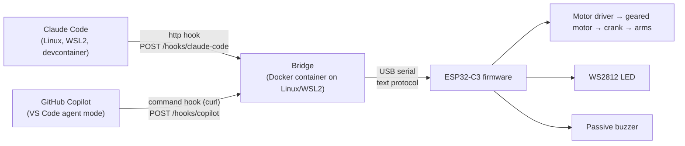

# Cody – Architecture

How the requirements in [requirements.md](requirements.md) are met. Requirements say *what*; this document says *how*. Every choice that was open is recorded: key technologies as decision records in section 5, everything else as a row in "Decisions" in [README.md](README.md).

## 1. Context and scope

Cody is built for the owner's own desk; the repository is open, but there is no build kit for others.

External systems: Claude Code and GitHub Copilot (their hook mechanisms), the host's USB port (data and all power), Meshy.ai (generates the head mesh, used manually), GitHub (CI, releases, GHCR).

Out of scope: arm home-position sensor; Wi-Fi/Bluetooth on the device; a build kit for others.

## 2. Constraints

- Power and data through one USB port of the host, ≤ 500 mA in total (ELE-04).
- Parts budget ≤ CHF 25 (ELE-06); printer Prusa MK3S+, FDM, PLA/PETG (FIG-03).
- Ready-made modules only; soldering limited to header pins and wires (ELE-01, ELE-02).
- Host: Linux or WSL2. On WSL2 the ESP32's USB device is attached with `usbipd-win` (manual step; `usbipd attach --auto-attach` survives replugs).
- GitHub Copilot's agent hooks are in Preview and may change; they provide no session id and no events for approval or failed turns.

## 3. Overview

| Folder | Content | Technology / tool |
|---|---|---|
| `spec/` | Specification | Markdown |
| `ci/` | Entry points for CI and releases (delivery.md 2) | Shell |
| `firmware/` | ESP32-C3 firmware with host unit tests | C++, Arduino-ESP32, PlatformIO (TD-01, TD-02) |
| `bridge/` | Host bridge: HTTP in, serial out, config, CLI, Dockerfile, compose file | Python, Docker (TD-03, TD-04) |
| `hooks/` | Hook configuration for Claude Code and Copilot, setup guide | JSON, shell |
| `cad/` | Code-CAD models, head mesh pipeline, model checks, print notes | Python, build123d, manifold3d (TD-05) |
| `electronics/` | BOM and wiring diagram | Markdown |
| `tools/` | Requirement report | Python |

## 4. Interfaces

### 4.1 Hooks → bridge (HTTP)

The hooks contain no logic: they forward the agent's own hook payload. All mapping lives in the bridge, so it is tested in CI with recorded payloads.

- Port `8765`. The bridge listens only on loopback and the local Docker/WSL interfaces (BRG-08); hooks in a devcontainer reach it via `host.docker.internal`.
- `POST /hooks/claude-code`: Claude Code's hook JSON as is, sent by an `http` hook (no script) configured in `~/.claude/settings.json`. Session key: `session_id`; event: `hook_event_name`.
- `POST /hooks/copilot`: Copilot's hook JSON, sent by a command hook (`curl -m 1 --data-binary @- …`) configured in `~/.copilot/hooks/`. Session key: workspace folder (`cwd`) (AGT-06).
- `GET /status`: device connection, firmware version, sessions with their states, merged state (BRG-11).
- Hooks time out after 1 s and never fail the agent (AGT-07).

**Claude Code mapping (AGT-01):**

| Hook event | State |
|---|---|
| `SessionStart` | IDLE |
| `UserPromptSubmit`, `PostToolUse`, `PostToolUseFailure` | THINKING |
| `PreToolUse` | WORKING |
| `PermissionRequest`, `Notification` (`permission_prompt`, `elicitation_dialog`) | APPROVAL |
| `Stop` | COMPLETED |
| `StopFailure` | ERROR |
| `SessionEnd` | session ends |

**Copilot mapping (AGT-04):**

| Hook event | State |
|---|---|
| `sessionStart` | IDLE |
| `userPromptSubmitted`, `postToolUse` | THINKING |
| `preToolUse` | WORKING |
| `agentStop` | COMPLETED |
| `sessionEnd` | session ends |

THINKING vs WORKING between tool calls is approximate for both agents.

### 4.2 Bridge → firmware (USB serial)

USB CDC of the ESP32-C3, 115200 baud, ASCII lines terminated by `\n`. Every command is answered with `OK` or `ERR <reason>` (FW-10).

| Command | Meaning | Req |
|---|---|---|
| `STATE:<IDLE\|WORKING\|THINKING\|APPROVAL\|COMPLETED\|ERROR>` | Switch state | FW-03 |
| `PING` | Heartbeat | FW-06, BRG-05 |
| `SPEED:<0-255>` | Motor PWM in WORKING | FW-08 |
| `VOLUME:<0-3>` | Sound volume, `0` = mute | FW-09 |
| `VERSION?` | Answered with `VERSION <version> <commit>` before `OK` | FW-11 |
| `LED:<r>,<g>,<b>` | Test: show a colour | FW-12 |
| `BEEP:<APPROVAL\|SUCCESS\|WARNING>` | Test: play a sound | FW-12 |

At boot the device sends `READY <version>`; the bridge then resends settings and state (BRG-06).

### 4.3 Mechanical interfaces

- Head ↔ torso: socket designed in code CAD and cut into the head mesh by the pipeline (TD-05).
- Electronics: modules mounted on a removable plate or compartment in the platform; USB port accessible from outside (FIG-14).

## 5. Technology stack

### 5.1 Overview

| Area | Choice | Version | Decision |
|---|---|---|---|
| Controller board | ESP32-C3 SuperMini | – | TD-01 |
| Firmware framework | Arduino-ESP32 3.x with PlatformIO (pioarduino platform) | pinned in step 1a | TD-02 |
| Bridge | Python | pinned in step 1a | TD-03 |
| Bridge runtime | Docker container, image on GHCR | – | TD-04 |
| CAD | build123d; head mesh from Meshy.ai, processed with manifold3d | pinned in step 1a | TD-05 |
| CI environment | Devcontainer (devcontainers/ci), Docker via docker-outside-of-docker | – | README.md "Decisions" |
| Python dependencies | uv with a lockfile per Python project | pinned in step 1a | README.md "Decisions" |
| Static checks | ruff (Python), clang-format (C++), shellcheck (shell) | pinned in step 1a | README.md "Decisions" |

Every tool has a pinned version and is installed in the devcontainer (`.devcontainer/`), never only on someone's machine. How CI gets the same tools is decided in delivery.md 2.

### 5.2 Decision records

Records are numbered `TD-<nn>` and never renumbered; a revised decision gets a new record and the old one is marked `superseded by TD-<nn>`.

#### TD-01 Controller board: ESP32-C3 SuperMini

**Status:** decided (2026-11-05)

**Context:** FW, ELE-04 (≤ 500 mA), ELE-06 (≤ CHF 25 for all parts), fits inside the platform. Needs 4 outputs (motor ×2, LED, buzzer) and USB serial.

**Options evaluated:** ESP32-C3 SuperMini (~CHF 2–4, 22 × 18 mm, native USB, few pins, varying clone quality); ESP32-S3 Zero/mini (~CHF 5–8, more than needed); classic ESP32 DevKitC (~CHF 5–8, large, USB-UART chip resets the board when the port opens).

**Decision:** ESP32-C3 SuperMini: cheapest, smallest, native USB, low power; enough pins.

**Consequences:** Buy two (cheap; clones vary). Native USB CDC: the serial port disappears on reset, which the bridge's reconnect handles (BRG-06).

#### TD-02 Firmware framework: Arduino-ESP32 with PlatformIO

**Status:** decided (2026-11-05)

**Context:** FW-01 – FW-12: WS2812, PWM tone, PWM motor, line parser; unit tests in CI without hardware.

**Options evaluated:** Arduino core + PlatformIO (easy libraries, host unit tests in the `native` environment, CLI fits CI; official PlatformIO lags behind Arduino-ESP32 3.x, so the community `pioarduino` platform is used); ESP-IDF (official, Unity tests incl. Linux target, more boilerplate); MicroPython (quick, weaker timing, harder to unit-test in CI).

**Decision:** Arduino-ESP32 with PlatformIO. Logic (parser, state machine, timing) is kept free of Arduino calls so it runs in the `native` test environment.

**Consequences:** Depends on the community `pioarduino` platform; if it stalls, revisit with ESP-IDF.

#### TD-03 Bridge language: Python

**Status:** decided (2026-11-05)

**Context:** BRG-01 – BRG-12: HTTP server, serial, config, CLI; Linux/WSL2.

**Options evaluated:** Python (proposed in the idea; pyserial, pytest, quick to change); Go (single binary, more code).

**Decision:** Python; it also serves the requirement report and the CAD scripts, so one language covers the host side.

**Consequences:** Runtime comes with the container image (TD-04).

#### TD-04 Bridge runtime: Docker container, image on GHCR

**Status:** decided (2026-11-05)

**Context:** BRG-06 (reconnect after replug), BRG-08 (local interfaces only), BRG-09 (autostart), runs on Linux/WSL2.

**Options evaluated:** native systemd user service (replug works without extra setup, one install step); Docker container (`restart: unless-stopped` gives autostart, pinned runtime; serial replug needs extra setup).

**Decision:** Docker container, started with a compose file from the release; image published on GHCR by `ci/publish` and retagged by `ci/promote`.

**Consequences:** The serial device appears and disappears on replug; the container mounts `/dev` (or `/dev/serial/by-id`) with a device cgroup rule for USB CDC (`ttyACM`) instead of a fixed `--device`. Reaching the bridge from devcontainers and keeping BRG-08 needs a network setup that binds only to loopback and the Docker bridge gateway. Both are risks (section 7) to be proven in stage 2; if they fail, revisit with a native service.

#### TD-05 CAD: build123d, head mesh from Meshy.ai

**Status:** decided (2026-11-05)

**Context:** FIG-01 – FIG-17: organic head, precise torso with mechanism, sources and print files in the repository, checks in CI.

**Options evaluated:** Fusion (strong organic + mechanical, proprietary files, no CI); build123d (Python code CAD on OpenCascade, headless exports and checks in CI, organic shapes hard); CadQuery (same kernel, older fluent API, larger community); FreeCAD (open source, scriptable, awkward UI).

**Decision:** build123d for platform, table, laptop, torso, arms and mechanism. The head is generated with Meshy.ai (manual, web); the raw mesh and the prompt are committed as sources, and a script with manifold3d repairs, scales and cuts the head socket and exports the printable STL.

**Consequences:** Model checks (height, bed size, part count, files present) run in CI. Meshy's licence terms for generated models must allow use in an open repository (open point in README.md).

## 6. Version information

| Artifact | How it reveals version and commit (REL-02) |
|---|---|
| Firmware | `VERSION?` command (FW-11) and the `READY <version>` line at boot; version in the `.bin` file name |
| Bridge | `--version` and `GET /status` (BRG-10); image tag and OCI labels |
| Print files | Version in file names and in the 3MF metadata |
| Hook configs, BOM, wiring | Version in file names of the release files |

## 7. Risks and open technical questions

| Risk | Mitigation |
|---|---|
| Motor, LED and buzzer exceed 500 mA (ELE-04), especially at motor start | Small N20 motor, PWM soft start, LED brightness limited; measured in stage 4. |
| Serial replug inside the Docker container (TD-04) | Mount `/dev` with a cgroup rule; prove in stage 2; fall back to a native service. |
| Copilot hook API (Preview) changes or reads Claude Code hook configs too (AGT-08) | Mapping in the bridge, not in hooks; recorded payloads in tests; dedupe by endpoint and payload format. |
| Crank fits in the torso with 3–8 mm hand travel (FIG-07, FIG-10) | Mechanism prototype first (stage 4), before the character. |
| Meshy mesh not printable or not watertight | manifold3d repair in the pipeline; regenerate. |

### 7.1 Findings from the spec review (2026-11-05)

Recorded as risks; the requirements are unchanged. The proposed fixes are not decided.

| # | Finding | Affects | Proposed fix (not decided) |
|---|---|---|---|
| R1 | "Set up once at user level" assumes one `~/.claude/settings.json`; inside a devcontainer Claude Code reads the container's home, and the bridge address differs (`127.0.0.1` on the host, `host.docker.internal` in a container). Every devcontainer would need its own setup. | AGT-02, AGT-03 | Require a hook URL that resolves on the host and in containers, and specify how the config reaches devcontainers (bind-mount or devcontainer feature), or narrow AGT-03 to "once per environment". |
| R2 | A session in COMPLETED stays until its next event or end; Claude Code sessions stay open for days, so after the first finished turn the figure shows green permanently and IDLE appears only after `/exit`. | BRG-02, BRG-04, FW-05 | COMPLETED falls back to IDLE after a configurable time in the bridge, or accept green as "nothing running" and drop IDLE from the merge order. |
| R3 | VS Code with the WSL or devcontainer extension runs Copilot's agent remotely; AGT-04 names no environments (unlike AGT-02), so its verification is undefined. | AGT-04 | Name the environments in AGT-04 or in a new requirement. |
| R4 | A USB meter shows averages; the current peak at motor start lasts milliseconds, so "including motor start" can't be verified as written. | ELE-04 | Average ≤ 500 mA plus a PWM start ramp of at least 200 ms, or an oscilloscope check. |
| R5 | Requirements without a measurable limit: "with margin" (ELE-03); volume levels of a passive buzzer (FW-09); the "disconnected" pattern blinks all night when the laptop sleeps with USB powered (FW-06). | ELE-03, FW-09, FW-06 | ELE-03: e.g. ≥ 1.5 × stall current. FW-09: levels audibly different. FW-06: subtle pattern (slow, dim pulse). |
| R6 | Scope of the CHF 25 is unclear: spare boards (TD-01 says buy two), screws, wire, USB cable. | ELE-06 | Define: one unit including consumables, spares excluded (or the other way round). |
| R7 | Docker is the riskiest choice for the least gain: a native service avoids replug and the BRG-08 network setup; GHCR adds `ci/publish`, `ci/promote` and `packages: write` to stage 1. | TD-04, BRG-06, BRG-08, REL | Prove Docker with the device in stage 2 first; add GHCR publishing only after that. |
| R8 | Smaller points: whether the head counts as a printed part (now separate, so 12 parts gets tighter); APPROVAL after a denied permission depends on the agent's next event (`PermissionDenied` not mapped); any local process can set the state. | FIG-04, AGT-01, BRG-08 | Clarify FIG-04; map `PermissionDenied`; record the unauthenticated local API as accepted. |

Open questions are listed in "Open points" in [README.md](README.md).
