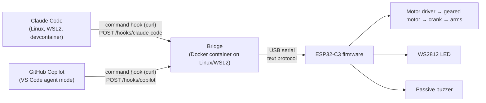

# Cody – Architecture

How the requirements in [requirements.md](requirements.md) are met. Requirements say *what*; this document says *how*. Every choice that was open is recorded: key technologies as decision records in section 5, everything else in the section it belongs to; choices that change the architecture also get a row in "Decisions" in [README.md](README.md).

## 1. Context and scope

Cody is built for the owner's own desk; the repository is open, and others can rebuild it from the parts list and assembly instructions (DOC).

External systems: Claude Code and GitHub Copilot (their hook mechanisms), the host's USB port (data and all power), Meshy.ai (generates the head mesh, used manually), GitHub (CI, releases, GHCR).

Out of scope: arm home-position sensor; Wi-Fi/Bluetooth on the device.

## 2. Constraints

- Power and data through one USB port of the host, ≤ 500 mA in total (ELE-04).
- Parts budget ≤ CHF 25 (ELE-06); printer Prusa MK3S+, FDM, PLA/PETG (FIG-03).
- Ready-made modules only; soldering limited to header pins and wires (ELE-01, ELE-02).
- Host: Linux or WSL2. On WSL2 the ESP32's USB device reaches WSL through `usbipd-win`. A one-time host setup is accepted for plug & play (BRG-06): install usbipd, `usbipd bind` the device once, and start `usbipd attach --wsl --auto-attach` at Windows login (e.g. a scheduled task); afterwards plug and replug need no action. The setup is described in the repository.
- GitHub Copilot's agent hooks are in Preview and may change; they provide no session id and no events for approval or failed turns.

## 3. Overview

| Folder | Content | Technology / tool |
|---|---|---|
| `spec/` | Specification | Markdown |
| `ci/` | Entry points for CI and releases (delivery.md 2) | Shell |
| `firmware/` | ESP32-C3 firmware with host unit tests | C++, Arduino-ESP32, PlatformIO (TD-01, TD-02) |
| `bridge/` | Host bridge: HTTP in, serial out, config, Dockerfile, compose file | Python, Docker (TD-03, TD-04) |
| `cli/` | Host command `cody`: status and manual state (BRG-11, BRG-12), setup (AGT-10) | Bash, curl |
| `hooks/` | Hook installers and configuration for Claude Code and Copilot, setup guide | Python (standard library), shell, JSON |
| `cad/` | Code-CAD models, head mesh pipeline, model checks, print notes | Python, build123d, manifold3d (TD-05) |
| `electronics/` | Wiring diagram: SVG block diagram of the modules with named pins and named nets, generated from a Python script | Python, schemdraw |
| `docs/` | Build documentation: parts list and assembly instructions (DOC) | Markdown, pictures and renders |
| `tools/` | Requirement report | Python |

## 4. Interfaces

### 4.1 Hooks → bridge (HTTP)

The hooks contain no logic: they forward the agent's own hook payload. All mapping lives in the bridge, so it is tested in CI with recorded payloads.

- Port `8765`. The bridge listens only on loopback and the local Docker interfaces, including the default bridge gateway `172.17.0.1` (BRG-08): its container uses the host network and binds exactly the configured addresses (`listen`, default `127.0.0.1` and `172.17.0.1`); only loopback and Docker's address range `172.16.0.0/12` are accepted. The hooks are command hooks using curl that try `localhost`, then `host.docker.internal`, then `172.17.0.1`, within 1 s in total (AGT-07), so the same configuration works on the host and in devcontainers (AGT-11), also with Docker Engine in WSL2, where `host.docker.internal` is not defined. Devcontainers that share the Claude Code configuration (e.g. the `claude-config` volume) are set up once; they need curl.
- `cody setup` (AGT-10) starts the bridge container with autostart, writes the hooks of both agents at user level, checks the device connection and reports what is missing (e.g. usbipd on WSL2).
- `POST /hooks/claude-code`: Claude Code's hook JSON as is, sent by the curl command hook configured in `~/.claude/settings.json`. Session key: `session_id`; event: `hook_event_name`.
- Claude Code hook: one inline shell command per event, with no file paths, so the same text works on the host and in containers:
  `p=$(cat); for h in 127.0.0.1 host.docker.internal 172.17.0.1; do printf '%s' "$p" | curl -s -o /dev/null --connect-timeout 0.3 -m 0.3 -H 'Expect:' --data-binary @- "http://$h:8765/hooks/claude-code" 2>/dev/null && break; done; exit 0`
  It never prints anything (stdout of some hooks goes into Claude's context), always exits 0, and takes at most about 0.9 s; the hook's own `timeout` is 2 s. The payload is piped, not passed as an argument, because tool outputs can be several MB; the bridge accepts up to 32 MB. `Expect:` stops curl from waiting for a `100 Continue` the bridge never sends.
- `hooks/install-claude-code` (Python, standard library only) merges these hooks into `$CLAUDE_CONFIG_DIR/settings.json` or `~/.claude/settings.json`, keeps all other settings, replaces earlier Cody hooks and can remove them (`--uninstall`). It is run once on the host and once for the devcontainers' shared `claude-config` volume (AGT-03); `cody setup` reuses it (AGT-10). `--record FILE` additionally appends every payload to a file, for recording real payloads as test fixtures (sanitised before they are committed). It needs any Python 3 (3.10 or newer) and no packages: in the repository run it with `uv run python hooks/install-claude-code`, elsewhere with the Python at hand (`python3 cody-install-claude-code-<version>`, the release file). It is shipped as a release file (delivery.md 2). The setup guide lists what installing and running the hooks needs on each machine: Python 3.10 or newer for the installer; curl and a POSIX shell wherever Claude Code runs (host and every devcontainer); the bridge running on the host.
- `POST /hooks/copilot`: Copilot's hook JSON, sent by a command hook (`curl -m 1 --data-binary @- …`) configured in `~/.copilot/hooks/`. Session key: workspace folder (`cwd`) (AGT-06).
- `GET /status`: device connection, firmware version, sessions with their states, merged state (BRG-11).
- `POST /state`: sets a state manually (`{"state": "WORKING"}`), as its own session `manual` (BRG-12); `DELETE /state` removes it, otherwise it ends by the session timeout.
- `DELETE /sessions`: removes all sessions, including the manual one; the merged state becomes IDLE (BRG-15).
- Host command `cody` (`cli/`): a shell script using curl on these endpoints: `cody status`, `cody state <STATE>`, `cody state clear`, `cody session clear` (BRG-15), `cody --version`; `cody setup` follows with AGT-10. Installed by copying it to `~/.local/bin`.
- Hooks return within 1 s and never fail the agent (AGT-07).

**Claude Code mapping (AGT-01):**

| Hook event | State |
|---|---|
| `SessionStart` | IDLE |
| `UserPromptSubmit`, `PostToolUse`, `PostToolUseFailure` | THINKING |
| `PreToolUse` | WORKING |
| `PermissionRequest`, `Notification` (`permission_prompt`, `elicitation_dialog`) | APPROVAL |
| `Stop` | COMPLETED |
| `StopFailure` | ERROR |
| `SessionEnd` | session ends |

**Copilot mapping (AGT-04):**

| Hook event | State |
|---|---|
| `sessionStart` | IDLE |
| `userPromptSubmitted`, `postToolUse` | THINKING |
| `preToolUse` | WORKING |
| `agentStop` | COMPLETED |
| `sessionEnd` | session ends |

THINKING vs WORKING between tool calls is approximate for both agents.

### 4.2 Bridge → firmware (USB serial)

USB CDC of the ESP32-C3, 115200 baud, ASCII lines terminated by `\n` (a `\r` before it is ignored). Commands and names are uppercase. A line longer than 64 characters is answered with `ERR line too long` and dropped. Every command is answered with `OK` or `ERR <reason>` (FW-10); an error never changes the state.

| Command | Meaning | Req |
|---|---|---|
| `STATE:<IDLE\|WORKING\|THINKING\|APPROVAL\|COMPLETED\|ERROR>` | Switch state | FW-03 |
| `PING` | Heartbeat | FW-06, BRG-05 |
| `SPEED:<0-255>` | Motor PWM in WORKING | FW-08 |
| `VOLUME:<0-3>` | Sound volume, `0` = mute | FW-09 |
| `VERSION?` | Answered with `VERSION <version> <commit>` before `OK` | FW-11 |
| `LED:<r>,<g>,<b>` | Test: show a colour (0–255 each) until the next `STATE` or a disconnect | FW-12 |
| `BEEP:<APPROVAL\|SUCCESS\|WARNING>` | Test: play a sound | FW-12 |

At boot the device sends `READY <version>`; the bridge then resends settings and state (BRG-06). Every valid command, including `PING`, counts as activity for the 30 s timeout (FW-06); the first one after power-up or a disconnect ends the "disconnected" pattern (FW-07). Sending the current state again doesn't replay its sound (FW-04: sounds play when a state is entered).

Flashing during development: the devcontainer mounts `/dev` with a device cgroup rule for USB CDC (`ttyACM`), like the bridge container, so `pio run -t upload` and the serial monitor work from VS Code. Only one process can open the port: the bridge is stopped while flashing (`docker compose stop`) and started again afterwards.

### 4.3 Device behaviour (defaults, tuned on the bench in step 2d)

| State | LED (r,g,b and effect) | Sound | Arms |
|---|---|---|---|
| IDLE | blue (0,0,255) steady at 15 % | – | stopped |
| WORKING | blue (0,0,255) pulsing 20–100 %, period 2 s | – | motor at `SPEED` |
| THINKING | yellow (255,160,0) steady at 50 % | – | stopped |
| APPROVAL | orange (255,80,0) blinking 1 Hz | double beep: 2 × 100 ms at 2.7 kHz, 100 ms apart | stopped |
| COMPLETED | green (0,255,0) steady at 50 % | success: rising 2.0 / 2.5 / 3.0 kHz, 100 ms each | stopped |
| ERROR | red (255,0,0) blinking 2 Hz | warning: falling 3.0 / 2.0 kHz, 200 ms each, twice | stopped |
| disconnected (FW-06, FW-07) | white slow pulse 0–10 %, period 4 s (unobtrusive at night) | – | stopped |

- LED brightness is capped at 50 % of full scale (ELE-04); the percentages above are relative to that cap.
- Buzzer: PWM at the tone frequency; volume by duty cycle, `VOLUME` 0 / 1 / 2 / 3 ≈ 0 / 3 / 12 / 50 %; levels must sound different on the bench (FW-09). A coil buzzer is driven through the DRV8833's second channel instead of a GPIO.
- Motor: PWM at about 20 kHz (inaudible); a kick start of 100 ms at full duty before dropping to `SPEED`; `SPEED:0` stops the motor.

Default pins of the ESP32-C3 SuperMini (avoiding the boot pins 2, 8, 9 and the USB pins 18, 19), confirmed with the wiring diagram in step 2d (ELE-07):

| Signal | GPIO |
|---|---|
| DRV8833 AIN1 / AIN2 (motor) | 3 / 4 |
| WS2812 data | 5 |
| Buzzer (piezo directly, or DRV8833 BIN1 for a coil buzzer) | 6 |
| DRV8833 BIN2 (held low; only used with a coil buzzer) | 7 |

### 4.4 Bridge configuration (BRG-07)

`~/.config/cody/bridge.toml` on the host, mounted read-only into the container by the compose file; a missing file or key means the default. Keys: `serial_port` (optional override), `speed` (default 128), `volume` (default 2), `session_timeout_min` (default 10), `listen` (default `["127.0.0.1", "172.17.0.1"]`), `log_level` (`"info"` or `"debug"`, default `"info"`).

The bridge is a Python program with the standard library's threaded HTTP server and pyserial for the port and device discovery. It finds the device among the serial ports by Espressif's USB vendor ID (`303A`) and accepts it only after `VERSION?` is answered (FW-11). It sends `PING` every 5 s (BRG-05).

Log (BRG-13, BRG-14): the bridge writes lines `YYYY-MM-DD HH:MM:SS LEVEL message` to stdout, for example `2026-11-06 14:02:11 INFO  state WORKING (sent) <- claude-code 3f2a1c PreToolUse`. Docker keeps them in its json-file log, limited by the compose file to 2 files of 10 MB (`max-size`, `max-file`); read with `docker compose logs`. Info: state changes with cause and delivery, device connects and losses, config. Debug: every event, and every command (`->`) and reply (`<-`) on the serial line. The container uses the host network and sees replugged devices through `/dev` mounted with a device cgroup rule for `ttyACM` devices.

### 4.5 Mechanical interfaces

- Head ↔ torso: socket designed in code CAD and cut into the head mesh by the pipeline (TD-05).
- Electronics: modules mounted on a removable plate or compartment in the platform; USB port accessible from outside (FIG-14).

## 5. Technology stack

### 5.1 Overview

| Area | Choice | Version | Decision |
|---|---|---|---|
| Controller board | ESP32-C3 SuperMini | – | TD-01 |
| Firmware framework | Arduino-ESP32 3.x with PlatformIO (pioarduino platform) | PlatformIO 6.2.0, pioarduino 55.03.312-1; toolchain baked into the devcontainer image | TD-02 |
| Bridge | Python | 3.14 | TD-03 |
| Bridge runtime | Docker container, image on GHCR | – | TD-04 |
| CAD | build123d; head mesh from Meshy.ai, processed with manifold3d | build123d 0.13.0, manifold3d 3.5.4 | TD-05 |
| CI environment | Devcontainer (devcontainers/ci), Docker via docker-outside-of-docker | – | delivery.md 2 |
| Python dependencies | uv workspace (members `bridge`, `cad`, `tools`) with one lockfile `uv.lock`; tests with pytest | uv 0.13.7, pytest 9.2.0 | this table |
| Static checks | ruff (Python), clang-format (C++), shellcheck (shell) | ruff 0.17.3, clang-format 23.1.5, shellcheck 0.11.0 | this table |
| Wiring diagram (ELE-07) | schemdraw (Python), SVG output | pinned in `uv.lock` when added in step 2d | this table |

Every tool has a pinned version and is installed in the devcontainer (`.devcontainer/`), never only on someone's machine. How CI gets the same tools is decided in delivery.md 2.

### 5.2 Decision records

Records are numbered `TD-<nn>` and never renumbered; a revised decision gets a new record and the old one is marked `superseded by TD-<nn>`.

#### TD-01 Controller board: ESP32-C3 SuperMini

**Status:** decided (2026-11-05)

**Context:** FW, ELE-04 (≤ 500 mA), ELE-06 (≤ CHF 25 for all parts), fits inside the platform. Needs 4 outputs (motor ×2, LED, buzzer) and USB serial.

**Options evaluated:** ESP32-C3 SuperMini (~CHF 2–4, 22 × 18 mm, native USB, few pins, varying clone quality); ESP32-S3 Zero/mini (~CHF 5–8, more than needed); classic ESP32 DevKitC (~CHF 5–8, large, USB-UART chip resets the board when the port opens).

**Decision:** ESP32-C3 SuperMini: cheapest, smallest, native USB, low power; enough pins.

**Consequences:** Buy two (cheap; clones vary). Native USB CDC: the serial port disappears on reset, which the bridge's reconnect handles (BRG-06).

#### TD-02 Firmware framework: Arduino-ESP32 with PlatformIO

**Status:** decided (2026-11-05)

**Context:** FW-01 – FW-12: WS2812, PWM tone, PWM motor, line parser; unit tests in CI without hardware.

**Options evaluated:** Arduino core + PlatformIO (easy libraries, host unit tests in the `native` environment, CLI fits CI; official PlatformIO lags behind Arduino-ESP32 3.x, so the community `pioarduino` platform is used); ESP-IDF (official, Unity tests incl. Linux target, more boilerplate); MicroPython (quick, weaker timing, harder to unit-test in CI).

**Decision:** Arduino-ESP32 with PlatformIO. Logic (parser, state machine, timing) is kept free of Arduino calls so it runs in the `native` test environment.

**Consequences:** Depends on the community `pioarduino` platform; if it stalls, revisit with ESP-IDF.

#### TD-03 Bridge language: Python

**Status:** decided (2026-11-05)

**Context:** BRG-01 – BRG-12: HTTP server, serial, config, CLI; Linux/WSL2.

**Options evaluated:** Python (proposed in the original idea; pyserial, pytest, quick to change); Go (single binary, more code).

**Decision:** Python; it also serves the requirement report and the CAD scripts, so one language covers the host side.

**Consequences:** Runtime comes with the container image (TD-04).

#### TD-04 Bridge runtime: Docker container, image on GHCR

**Status:** decided (2026-11-05)

**Context:** BRG-06 (reconnect after replug), BRG-08 (local interfaces only), BRG-09 (autostart), runs on Linux/WSL2.

**Options evaluated:** native systemd user service (replug works without extra setup, one install step); Docker container (`restart: unless-stopped` gives autostart, pinned runtime; serial replug needs extra setup).

**Decision:** Docker container, started with a compose file from the release; image published on GHCR by `ci/publish` and retagged by `ci/promote`.

**Consequences:** The serial device appears and disappears on replug; the container mounts `/dev` (or `/dev/serial/by-id`) with a device cgroup rule for USB CDC (`ttyACM`) instead of a fixed `--device`. Reaching the bridge from devcontainers and keeping BRG-08 needs a network setup that binds only to loopback and the Docker bridge gateway. Both are risks (section 7) to be proven in stage 2; if they fail, revisit with a native service.

#### TD-05 CAD: build123d, head mesh from Meshy.ai

**Status:** decided (2026-11-05)

**Context:** FIG-01 – FIG-17: organic head, precise torso with mechanism, sources and print files in the repository, checks in CI.

**Options evaluated:** Fusion (strong organic + mechanical, proprietary files, no CI); build123d (Python code CAD on OpenCascade, headless exports and checks in CI, organic shapes hard); CadQuery (same kernel, older fluent API, larger community); FreeCAD (open source, scriptable, awkward UI).

**Decision:** build123d for platform, table, laptop, torso, arms and mechanism. The head is generated with Meshy.ai (manual, web); the raw mesh and the prompt are committed as sources, and a script with manifold3d repairs, scales and cuts the head socket and exports the printable STL.

**Consequences:** Model checks (height, bed size, part count, files present) run in CI. Meshy's licence terms for generated models must allow use in an open repository (open point in README.md).

## 6. Version information

| Artifact | How it reveals version and commit (REL-02) |
|---|---|
| Firmware | `VERSION?` command (FW-11) and the `READY <version>` line at boot; version in the `.bin` file name |
| Bridge | `--version` and `GET /status` (BRG-10); image tag and OCI labels |
| Print files | Version in file names and in the 3MF metadata |
| Hook installer, parts list, assembly instructions, wiring | Version in file names of the release files |

## 7. Risks and open technical questions

| Risk | Mitigation |
|---|---|
| Motor, LED and buzzer exceed 500 mA (ELE-04), especially at motor start | Small N20 motor, PWM soft start, LED brightness limited; measured in stage 4. |
| Serial plug & play inside the Docker container (TD-04, BRG-06) | Mount `/dev` with a cgroup rule; step 2d must demonstrate first plug-in and replug in the container; if it fails, switch to a native service (new TD). |
| Copilot hook API (Preview) changes or reads Claude Code hook configs too (AGT-08) | Mapping in the bridge, not in hooks; recorded payloads in tests; dedupe by endpoint and payload format. |
| Crank fits in the torso with 3–8 mm hand travel (FIG-07, FIG-10) | Mechanism prototype first (stage 4), before the character. |
| Meshy mesh not printable or not watertight | manifold3d repair in the pipeline; regenerate. |

Open questions are listed in "Open points" in [README.md](README.md).
