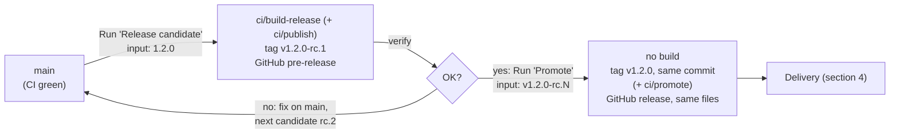

# Cody – Delivery

Version scheme, CI, releases and how releases reach their users. Requirements: REL in [requirements.md](requirements.md).

## 1. Version scheme

Versions follow [Semantic Versioning](https://semver.org).

| Build | Built by | Version inside the artifact | Git tag | Published as |
|---|---|---|---|---|
| Pull request, push to `main` | `ci.yml` | `<last release>+build.<N>` | – | CI artifact `reports` (results, requirement report) |
| Release candidate | `release-candidate.yml` | `<version>` | `v<version>-rc.<M>` | GitHub pre-release with the release files |
| Release | `promote.yml` (no build) | unchanged: `<version>` | `v<version>` | GitHub release (latest) with the candidate's release files |
| Local build | developer | `<last release>+local.<short commit>` | – | – |

- `<last release>` is the highest tag `vX.Y.Z` without suffix reachable from the built commit, or `0.0.0` if there is none.
- `<N>` is the run number of `ci.yml`; it increases with every run and is never reused.
- All candidates of one version contain the same version `<version>`; they are told apart by their commit.

| Version step | When |
|---|---|
| MAJOR | Incompatible change <!-- TODO(blueprint): what counts as incompatible in this project (file formats, interfaces, mechanical fit, …) --> |
| MINOR | New features, backward-compatible additions |
| PATCH | Fixes only |

## 2. CI and the entry points

- `main` is always releasable. Work happens on short-lived branches (one per stage, `feature/stage-<n>[-<text>]`) merged into `main` through pull requests.
- Workflow `ci.yml` runs on every pull request and every push to `main` and calls `ci/check`.
- The requirement report is part of `ci/check`. Its Markdown report is shown in the run summary and uploaded with all results as the artifact `reports`.

### CI environment

<!-- TODO(blueprint): decide and record in README.md "Decisions". Options:
1. (Default in the workflows) The devcontainer: the workflows build `.devcontainer/` and run the entry points inside it (devcontainers/ci). Same tools as local development, no extra setup; slower when the image is large.
2. The runner directly: replace the devcontainers/ci steps with setup steps for the toolchain (setup actions, caches). Faster, but the tool versions must be kept in sync with the devcontainer by hand.
3. A dedicated CI image or self-hosted runner: when tools need licences or hardware (CAD, HIL benches).
-->

### Entry points

The workflows are the same for every project and know nothing about its technology. What is checked, built and published is defined by executables in `ci/`, written in stage 1 in whatever the toolchain offers (shell, Python, PowerShell, Make, a CAD tool's batch mode, …).

All entry points:

- are executable files (`chmod +x`, with a shebang line), run from the repository root in the CI environment;
- exit `0` on success and non-zero on failure;
- receive `VERSION` (section 1) and `COMMIT` (full commit hash) as environment variables; run locally without `VERSION`, they use `<last release>+local.<short commit>`.

| Entry point | Required | Called by | Extra environment | Must do |
|---|---|---|---|---|
| `ci/check` | yes | `ci.yml` (every PR and push to `main`; again for each release candidate) | – | Run all automated verification, write results to `reports/`, run the requirement report last (`reports/requirements.md`). Fail if anything fails. |
| `ci/build-release` | yes | `release-candidate.yml` | `RELEASE_DIR`: empty folder | Build the release files with `VERSION` and `COMMIT` baked in, and put every file users should download into `RELEASE_DIR` (flat, no subfolders). May leave it empty when everything is delivered by `ci/publish`. |
| `ci/publish` | no | `release-candidate.yml`, after `ci/build-release` | `RELEASE_DIR`, `CANDIDATE_TAG` (`v1.2.0-rc.1`) | Publish the candidate somewhere other than GitHub: container registry, package index, store, file server. Never overwrite something already published. |
| `ci/promote` | no | `promote.yml` | `CANDIDATE_TAG`, `RELEASE_TAG` (`v1.2.0`) | Promote what `ci/publish` published **without rebuilding** (e.g. add the tags `1.2.0`, `1.2`, `1` to the candidate's image). |

- Files in `RELEASE_DIR` are attached to the GitHub pre-release; promotion attaches the very same files to the release. "Download only" delivery needs just `ci/check` and `ci/build-release`.
- Entry points that publish need credentials: add them as repository secrets and pass them in the workflow step that runs the entry point (marked `TODO(blueprint)`; with devcontainers/ci both under `env:` of the step and in its `env` list). `GITHUB_TOKEN` is not passed by default.

<!-- TODO(blueprint): the project's choices: what ci/check runs, what the release files are, whether publish/promote exist. -->

## 3. Release flow

**`release-candidate.yml`**, started manually with input `version` (e.g. `1.2.0`):

1. Checks that it runs on `main`, that CI passed for this commit, that `version` is `X.Y.Z`, higher than the latest release, and not released yet.
2. Determines the candidate number M (one more than the highest `v<version>-rc.*`, starting at 1).
3. Runs the full CI again (`ci.yml`).
4. Runs `ci/build-release` (and `ci/publish`, if present) with version `<version>`, without the `-rc.M` suffix.
5. Tags `v<version>-rc.M` and creates a GitHub pre-release with notes since the last release and every file in `$RELEASE_DIR`.

**`promote.yml`**, started manually with input `candidate` (e.g. `v1.2.0-rc.2`):

1. Checks that the candidate exists, that it is the latest candidate of its version, and that `v<version>` does not exist yet.
2. Runs `ci/promote` as it was in the candidate's commit, if present.
3. Tags `v<version>` on the candidate's commit and creates the GitHub release (latest) with the candidate's release files, downloaded from its pre-release, unchanged.

**Rules**

- Releases and candidates are immutable. A problem in `1.2.0-rc.1` is fixed on `main` and becomes `1.2.0-rc.2`; a problem after `1.2.0` becomes `1.2.1`.
- Releases are made from `main` only; no release branches. Hotfixes take the same path with a patch version.
- Tags `v*` are protected by a repository ruleset (REL-05), set up once by the project owner.

## 4. Delivery to users

<!-- TODO(blueprint): choose one and describe it; record the choice in README.md "Decisions".

Options:
1. Download only: users get the release files from the GitHub release. Nothing else to do.
2. Distribution: `ci/publish` / `ci/promote` push to a registry, store or file server.
3. Deployment: a project-defined, manually started step (script or extra workflow) installs a release into an environment (staging, production, devices). Describe environments, who triggers it, and rollback.
-->

## 5. Environments

<!-- TODO(blueprint): only if section 4 involves deployment: staging/production, test benches, devices. Otherwise "None". -->
