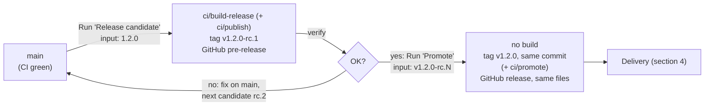

# Cody – Delivery

Version scheme, CI, releases and how releases reach their users. Requirements: REL in [requirements.md](requirements.md).

## 1. Version scheme

Versions follow [Semantic Versioning](https://semver.org).

| Build | Built by | Version inside the artifact | Git tag | Published as |
|---|---|---|---|---|
| Pull request, push to `main` | `ci.yml` | `<last release>+build.<N>` | – | CI artifact `reports` (results, requirement report) |
| Release candidate | `release-candidate.yml` | `<version>` | `v<version>-rc.<M>` | GitHub pre-release with the release files |
| Release | `promote.yml` (no build) | unchanged: `<version>` | `v<version>` | GitHub release (latest) with the candidate's release files |
| Local build | developer | `<last release>+local.<short commit>` | – | – |

- `<last release>` is the highest tag `vX.Y.Z` without suffix reachable from the built commit, or `0.0.0` if there is none.
- `<N>` is the run number of `ci.yml`; it increases with every run and is never reused.
- All candidates of one version contain the same version `<version>`; they are told apart by their commit.

| Version step | When |
|---|---|
| MAJOR | Incompatible change: the serial protocol or the bridge HTTP API changes so that firmware and bridge (or hooks) must be updated together, or printed parts no longer fit parts or modules of the previous release |
| MINOR | New features, backward-compatible additions |
| PATCH | Fixes only |

## 2. CI and the entry points

- `main` is always releasable. Work happens on short-lived branches (one per stage, `feature/stage-<n>[-<text>]`) merged into `main` through pull requests.
- Workflow `ci.yml` runs on every pull request and every push to `main` and calls `ci/check`.
- The requirement report is part of `ci/check`. Its Markdown report is shown in the run summary and uploaded with all results as the artifact `reports`.

### CI environment

The devcontainer: the workflows build `.devcontainer/` and run the entry points inside it (devcontainers/ci), so CI uses the same pinned tools as development (PlatformIO with the ESP32 toolchain, Python with build123d and manifold3d, Docker CLI for the bridge image).

Image cache: `ci.yml` pushes the built devcontainer image to GHCR as `ghcr.io/<owner>/<repo>-devcontainer` on every push to `main` and uses it as build cache in every run (`cacheFrom`), so the toolchain is rebuilt only when `.devcontainer/` or the lock files change. Pull requests and release candidates only read the cache. The job needs `packages: write`; the caller in `release-candidate.yml` grants it too. In CI the post-create step (`.devcontainer/post-create.sh`) gives the toolchain folders to the runner's UID, which devcontainers/ci assigns to the container user.

### Entry points

The workflows are the same for every project and know nothing about its technology. What is checked, built and published is defined by executables in `ci/`, written in stage 1 in whatever the toolchain offers (shell, Python, PowerShell, Make, a CAD tool's batch mode, …).

All entry points:

- are executable files (`chmod +x`, with a shebang line), run from the repository root in the CI environment;
- exit `0` on success and non-zero on failure;
- receive `VERSION` (section 1) and `COMMIT` (full commit hash) as environment variables; run locally without `VERSION`, they use `<last release>+local.<short commit>`.

| Entry point | Required | Called by | Extra environment | Must do |
|---|---|---|---|---|
| `ci/check` | yes | `ci.yml` (every PR and push to `main`; again for each release candidate) | – | Run all automated verification, write results to `reports/`, run the requirement report last (`reports/requirements.md`). Fail if anything fails. |
| `ci/build-release` | yes | `release-candidate.yml` | `RELEASE_DIR`: empty folder | Build the release files with `VERSION` and `COMMIT` baked in, and put every file users should download into `RELEASE_DIR` (flat, no subfolders). May leave it empty when everything is delivered by `ci/publish`. |
| `ci/publish` | no | `release-candidate.yml`, after `ci/build-release` | `RELEASE_DIR`, `CANDIDATE_TAG` (`v1.2.0-rc.1`) | Publish the candidate somewhere other than GitHub: container registry, package index, store, file server. Never overwrite something already published. |
| `ci/promote` | no | `promote.yml` | `CANDIDATE_TAG`, `RELEASE_TAG` (`v1.2.0`) | Promote what `ci/publish` published **without rebuilding** (e.g. add the tags `1.2.0`, `1.2`, `1` to the candidate's image). |

- Files in `RELEASE_DIR` are attached to the GitHub pre-release; promotion attaches the very same files to the release. "Download only" delivery needs just `ci/check` and `ci/build-release`.
- Entry points that publish need credentials: add them as repository secrets and pass them in the workflow step that runs the entry point (marked `TODO(blueprint)`; with devcontainers/ci both under `env:` of the step and in its `env` list). `GITHUB_TOKEN` is not passed by default.

### Project choices

Everything a user needs to make Cody work is a release file; nothing has to be taken from the repository.

| Entry point | Does in Cody |
|---|---|
| `ci/check` | Firmware unit tests (PlatformIO `native`), firmware build, bridge tests (pytest), hook mapping tests, CAD model checks, requirement report tests; then the requirement report. |
| `ci/build-release` | Into `RELEASE_DIR`: firmware as one combined image `cody-firmware-<version>.bin` (bootloader, partition table and app, flashed at 0x0), print files (3MF/STL), compose file for the bridge, hook installer `cody-install-claude-code-<version>` (Python script) and setup guide, host command `cody-<version>` (shell script), parts list as CSV and assembly instructions as PDF rendered from the Markdown (DOC-06), wiring diagram, each with the version in its name; and `LICENSE`. |
| `ci/publish` | Builds the bridge image and pushes it to GHCR as `cody-bridge:<version>-rc.<M>` (from `CANDIDATE_TAG`); needs `packages: write`. |
| `ci/promote` | Adds the tags `<version>` and `latest` to the candidate's image on GHCR, without rebuilding; needs `packages: write`. |

The bridge image on GHCR is public, so the compose file pulls it without a login. It carries the OCI labels for version, commit, source repository and licence (`MIT`). `ci/publish` and `ci/promote` log in to GHCR with the workflow's `GITHUB_TOKEN` (`packages: write`), passed into the devcontainer; no personal token is needed. The entry points get Docker through the devcontainer feature docker-outside-of-docker. The first release (stage 1) contains skeletons: firmware that only sends `READY <version>`, and a bridge image that only answers `--version`, with its compose file.

## 3. Release flow

**`release-candidate.yml`**, started manually with input `version` (e.g. `1.2.0`):

1. Checks that it runs on `main`, that CI passed for this commit, that `version` is `X.Y.Z`, higher than the latest release, and not released yet.
2. Determines the candidate number M (one more than the highest `v<version>-rc.*`, starting at 1).
3. Runs the full CI again (`ci.yml`).
4. Runs `ci/build-release` (and `ci/publish`, if present) with version `<version>`, without the `-rc.M` suffix.
5. Tags `v<version>-rc.M` and creates a GitHub pre-release with notes since the last release and every file in `$RELEASE_DIR`.

**`promote.yml`**, started manually with input `candidate` (e.g. `v1.2.0-rc.2`):

1. Checks that the candidate exists, that it is the latest candidate of its version, and that `v<version>` does not exist yet.
2. Runs `ci/promote` as it was in the candidate's commit, if present.
3. Tags `v<version>` on the candidate's commit and creates the GitHub release (latest) with the candidate's release files, downloaded from its pre-release, unchanged.

**Rules**

- Releases and candidates are immutable. A problem in `1.2.0-rc.1` is fixed on `main` and becomes `1.2.0-rc.2`; a problem after `1.2.0` becomes `1.2.1`.
- Releases are made from `main` only; no release branches. Hotfixes take the same path with a patch version.
- Tags `v*` are protected by a repository ruleset (REL-05), set up once by the project owner: target `v*`, rules "Restrict updates", "Restrict deletions" and "Block force pushes", no bypass. "Restrict creations" is not used: the workflows push tags with `GITHUB_TOKEN`, and GitHub can't put the built-in GitHub Actions actor on a bypass list. Tags are created only by the release workflows by convention (single owner; Claude is denied tag commands).

## 4. Delivery to users

Download only, plus the bridge image on GHCR. The owner downloads the release files from the GitHub release, flashes the firmware, prints the parts, runs the hook installer, and starts the bridge with the compose file, which pulls `cody-bridge:<version>` from GHCR. Recorded in README.md "Decisions".

## 5. Environments

None.
